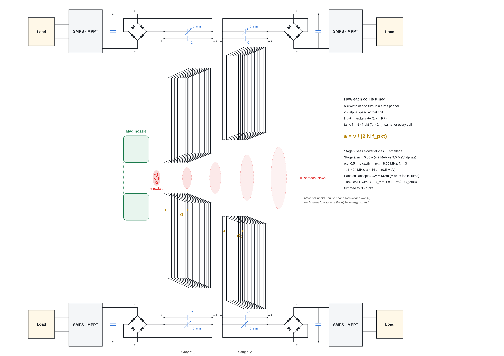

# TwinPhase Resonant Fusor: supplementary material to Version X

**Author:** Marcus Roberts

This file holds material that supports the Version X paper (paper/TwinPhase_Resonant_Fusor_Version_X_clean_2026-11-02.md) but is kept out of it to keep the paper lean. It has three parts: the inductive harvester that Version X mentions as an option for a bunched mode (S1), the earlier short-packet treatment of space charge (S2), and the earlier reaction-rate model for bunched packets (S3). A holding note on flat ribbon streams follows (S4). References to section, appendix, principle and OMR numbers, written as "Version X §n", point into the paper. Figures here are numbered S1 and up so that they do not clash with the paper's figures. Version X takes continuous long streams as its base configuration, so the bunched-packet material below is background and an option, not the base case. Licence: CC BY 4.0, see LICENSE. Any use or quotation must credit the author.

## S1. Inductive harvester for a bunched mode

Version X keeps this design as a one-line option for a bunched mode (Version X §10.1). It is written here for the case where the alpha output arrives in pulses, not as a steady current.

### S1.0 Alpha dynamics and energy harvesting in a bunched mode

Each fusion event yields two alpha particles. In a bunched mode, TwinPhase’s direct-energy-conversion (DEC) chain, which turns the alphas' kinetic energy straight into electricity without a heat cycle, would have three stages. First, magnetic nozzles collimate and expand the alpha exhaust. Next, an inductive stage recovers a first fraction of the directed energy. Finally, an electrostatic stage captures the remaining ion energy. Electrostatic direct conversion is well established [Moir & Barr, 1973; Barr & Moir, 1983; Takeno et al., 2019; Xie et al., 2025; full references as listed in Version X] and is the base converter in Version X §10.1 and is not developed further here. The magnetic nozzles sit at ground potential, consistent with Principle 1 of Version X.

> **Worked example (exact): alpha stopping voltage.**
> With $Q = 17.35\,\mathrm{MeV}$ and the working point $E_{\mathrm{rel}} = 1.55\,\mathrm{MeV}$, each alpha carries about $9.45\,\mathrm{MeV}$ in the CM (Version X §5). For $\alpha^{2+}$ the electrostatic stopping voltage is $V_{\mathrm{stop}} = E_\alpha/(2e) \approx 4.72\,\mathrm{MV}$, about three times the ~1.5 MV class of the fuel electrodes, so the electrostatic DEC stage is a *separate*, higher-voltage collector after the inductive stage, not a reuse of the outer-reflector supply. At the equal-momentum design point the pair CM is at rest, so the alpha energy spread is close to zero. If the split drifts away from equal momentum the spread grows; as a design case, a strongly unequal split (e.g. $E_p\approx 1.53\,\mathrm{MeV}$, $E_{\mathrm{Li}}\approx 0.06\,\mathrm{MeV}$) gives a laboratory collinear half-range of about $\pm 0.9\,\mathrm{MeV}$, which the nozzle/harvester acceptance should accommodate **[OMR-16]**.

In the bunched option the inductive harvester (Figure S1) is the first conversion stage. Each harvester is one continuous ten-turn coil of parallelogram turns beside the alpha exhaust, downstream of the magnetic nozzle. As an alpha packet passes, its ring-shaped magnetic field cuts first one vertical wire of a turn and then the other, a time $t = a/v$ later, where $a$ is the width of one turn and $v$ is the alpha speed ($\approx 2.14\times10^{7}\,\mathrm{m/s}$ at 9.5 MeV). The induced voltage swings positive then negative, so one full cycle has period $2a/v$. The coil’s own inductance $L$ forms a resonant tank circuit with a fixed capacitor and a trim capacitor (total capacitance $C$) across its in and out leads, so the tank resonates at $f = 1/(2\pi\sqrt{LC})$. The turn width is chosen so that this swing matches the tank, which runs at $N$ times the packet rate (S1.1). For example, a 0.5 m proton cavity with a ramp reflector has a 4.03 MHz bounce frequency (Version X Appendix M.5) and two head-on crossings per bounce, so it gives alpha pulses at about 8.06 MHz (Version X §6.1); with $N = 3$ the tank runs at about 24 MHz and $a \approx 44\,\mathrm{cm}$ for 9.5 MeV alphas. A bridge rectifier across the tank and a smoothing capacitor feed a switch-mode supply with maximum-power-point tracking (SMPS-MPPT), which drives the load. There are two stages, each with one coil above and one below the axis; the second stage sits further out to follow the spreading, slowing packet. The alphas have slowed by the time they reach stage 2, so its coils are tuned for a lower $v$: a smaller turn width $a$ keeps $f$ the same. Magnetic coupling to alphas moving at about 7 % of the speed of light is unproven, so no conversion percentage is claimed here **[OMR-16]**. The coils also see each alpha packet on its own, so a packet holding only a few alphas gives a noisy, Poisson-distributed drive; this sets a minimum packet population for harvester operation, separate from the average rate (Version X Appendix M.6) **[OMR-08]**.

How DEC efficiency depends on alpha energy, angular spread and beam quality, together with the detailed nozzle optics, is **[OMR-16]**. Ash management is addressed in Version X §11.

### S1.1 Design principle: the inductive harvester

*Why inductive.* Few harvesters have been designed or built for the regime TwinPhase operates in: alpha packets at several MeV arriving at MHz rates. Electrostatic direct conversion is well established for slower, continuous ion flows, and travelling-wave converters for MeV ions remain largely at laboratory scale [Takeno et al., 2019]. TwinPhase therefore takes an inductive approach. The bunched alpha stream is treated as a pulsed current, and its magnetic field is coupled into tuned coils. This choice does not exclude other harvester architectures. Any converter that suits the packet energies and rates can be substituted.

*Tank tuned to the packet rate.* Each coil's tank resonates at a whole multiple $N$ of the alpha packet rate $f_{\mathrm{pkt}}$, so every packet tops up the oscillation in phase. $N$ is kept small (about 2 to 4), so the tank only has to ring for a few cycles between packets, and a modest quality factor Q (a measure of how slowly the oscillation dies away) carries it through the gap. Because the packet rate comes from the RF drive, every coil on a machine shares one tank frequency, and the RF provides the reference for locking to it. A shorter proton cavity raises the packet rate and eases the coil design. The coil's own inductance serves as the tank inductor, so no separate inductor is needed. Each tank carries a trim capacitor so it can be tuned to $N f_{\mathrm{pkt}}$ on the bench; a varactor could later let the RF control loop track it automatically. Because a single-layer coil of this size has low inductance, the tank capacitance is small and stray capacitance must be included in the tuning.

*Turn width set by alpha speed.* Once the tank frequency is fixed, the turn width follows from the alpha speed $v$: $a = v/(2Nf_{\mathrm{pkt}})$, so $a$ scales with the speed of the alphas a coil is meant to catch. Coils further downstream, which see slowed packets, have narrower turns. Alphas from p-⁶Li reactions (about 1.7 MeV) use the same coils intended for these slowed packets. A built harvester would likely use a spectrum of perhaps 10 to 20 coil elements, tuned for progressively lower-energy packets further from the nozzles. ⁶Li burn (Mode 3) will need changes to the DC reflector voltages. It may be possible to keep the same RF drive frequency by DC changes alone, or Mode 3 may need a different drive frequency, and hence packet frequency. Because every tank is tuned to $N f_{\mathrm{pkt}}$, a different frequency would detune the whole tank bank. Which applies is open **[OMR-17]**.

*Figure S1. Inductive alpha harvester (schematic h22). The alpha packet leaves the magnetic nozzle and spreads as it travels along the axis. In this example four tuned coils, two stages above and two below the axis, each feed a tank (coil plus fixed and trim capacitors), bridge rectifier, smoothing capacitor, SMPS-MPPT converter and load. $a$ is the width of one coil turn. Every tank runs at the same frequency, $N$ times the packet rate, and each coil’s turn width is set by $a = v/(2Nf_{\mathrm{pkt}})$, so stage 2 (right), which sees slower alphas, has narrower turns ($a_2 \approx 0.86\,a$).*

*Self-sorting by energy.* As the figure shows, each coil is built for one alpha speed, and a coil couples strongly only to packets whose speed matches its turn width. For $n$ turns the acceptance is roughly $\Delta v/v \approx 1/(2n)$, about ±5% in speed or ±10% in energy for 10 turns. A bank of coils tuned across the expected energy spread, arranged both radially and axially, therefore draws energy from each packet at the coil that matches it. More turns per coil gives stronger coupling but narrower acceptance. The best balance between turns per coil, number of coils and coupling strength is **[OMR-17]**.

*An option: more packet pairs.* Because the tank only has to ring through the idle gap between packets, anything that shortens the gap eases the circuit. Running an odd number h of matched proton and lithium packet pairs, equal for both species so that every crossing at the centre stays head-on, raises the alpha packet rate by the factor h while leaving the fusion in each packet unchanged. A coil built to the same turn width can then be tuned to N/h times the new packet rate, so the number of tank cycles it must carry through each gap, and the quality factor it needs, fall by the factor h, down to a floor of one cycle because successive packets must arrive a whole number of tank cycles apart. Alternatively N can be kept and the coil made h times narrower. The price is that the reflectors and RF hold h times the charge, the alpha bunches must stay shorter than their spacing, which shrinks by the same factor, and the gain only appears once each packet carries enough alphas to drive the tank coherently **[OMR-08]**. This is offered as an option to be weighed in the coupled circuit model rather than as part of the baseline **[OMR-17]**.

---

## S2. Short-packet space-charge treatment

This is the earlier treatment of space charge for short packets. Version X §11.1 replaces it with the ions-per-metre framing for long streams. The first-order figures here are for round short packets and stay useful as the short-packet end of the comparison.

This section flags several loss and stability channels, mostly in qualitative terms. TwinPhase does not claim to have suppressed any of them. This manuscript is an architecture precursor to modelling and a modest proof-of-concept (POC): losses that would be unacceptable in a power plant can be accepted at the paper and early-device stage, provided they are named and a later mitigation path is visible.

### S2.1 Space-charge-limited yield for short packets

Each packet's own electric field (space charge) pushes its ions apart and limits how many ions a packet can hold. Space charge has become the problem that most needs attention, and this subsection records what first-order work has established so far. The figures below are indicative orders of magnitude from simple envelope models with emittance neglected; they are offered as open questions for the community rather than as results **[OMR-07]** **[OMR-18]**.

**The transverse cap and the convergence energy.** A packet is launched converging so that it reaches its smallest spot at the meeting point. The energy that does this, written here as $E_{\perp}$ (the coherent inward, or perpendicular, part of each ion's kinetic energy), is a slice of the energy the ion gains from the reflector potential, tipped inward by electrostatic lensing and magnetic compression. It is ordered motion of the packet as a whole, not random spread; random spread is emittance, and it works against the focus. How much charge a packet can carry into the spot is set by whether $E_{\perp}$ is enough to climb the packet's own space-charge potential. $E_{\perp}$ helps on the way in, but after the spot the same inward motion, with space charge added, carries the ions out diverging, and the reflectors must refocus them before the next pass. The working reference has been $E_{\perp}$ at $10\,\%$ of ion energy, about an $18^{\circ}$ convergence.

**Scaling with the convergence share.** Both the $^7\mathrm{Li}$ and proton caps grow with $E_{\perp}$, and the yield is their product, so yield per crossing rises roughly as the square of the $E_{\perp}$ share. Nothing in the first-order physics sets an optimum: the practical limit comes from the beam optics, in particular from refocusing the diverging packet every pass, where aberrations appear to grow quickly above about $30^{\circ}$ (an $E_{\perp}$ share near $25\,\%$). The angular smear of collision energy from the convergence is small at these angles. Where the refocusing limit really lies is open.

**The axial self-field.** The packet's own field along the axis also limits how much charge fits in a short packet at the spot. It scales with $E_{\perp}$ in the same way, so it shapes the numbers without stopping the rise, and an axial magnetic field does little to relieve it.

**The beam-beam kick.** When the packets cross, the proton packet, which carries far more charge than the $^7\mathrm{Li}$ packet, deflects the $^7\mathrm{Li}$ ions. For round packets at the reference loading the first-order kick on $^7\mathrm{Li}$ is large, of order $0.7\,\mathrm{rad}$ in a single crossing, enough to disrupt the lithium packet, while the kick on the protons is about $0.01\,\mathrm{rad}$. How this coupling evolves over many passes is a central open question.

**Ribbon packets.** Flat ribbon packets (wide in one direction and thin in the other, the standard collider answer to beam-beam limits) let packet charge grow with width while the field on the thin edge stays manageable. First-order estimates give a few times more yield for a $100 \times 0.05\,\mathrm{mm}$ ribbon than for a round packet, growing roughly as the square root of the width, and a beam-beam kick on $^7\mathrm{Li}$ about 10 times smaller. Ribbons would be formed by a slit extraction aperture and trimmed by a segmented quadrupole lens (Version X §12); the axial field's Larmor rotation tends to smear a ribbon round, so holding and refocusing ribbons over many passes is open. Choosing the field so the rotation per bounce cycle is a whole number of turns for both species may turn this into a phasing control (Version X §12).

**Holding the waist.** External focusing could hold the packets at their waist through the interaction zone, removing the depth-of-focus loss (about a factor of 5 in first-order estimates). The axial cap then binds instead, and the fields needed to hold the packets against their own charge, and the $^7\mathrm{Li}$ packet inside the proton packet, are very large.

**Charge state.** The caps limit charge, not nuclei, and the self-force scales as $Z^{2}$ ($Z$ is the ion charge number). Carrying fuel on low-charge ions, such as $^7\mathrm{Li}^{+}$ instead of $^7\mathrm{Li}^{3+}$, raises the nuclei per packet on paper, but first-order estimates suggest the carrier is stripped by the proton packet long before it reacts, which pulls it out of the lock.

**Fuels tried.** The same model applied to p-$^7\mathrm{Li}$ at the aneutronic point (about $1.55\,\mathrm{MeV}$ CM, of order $10^{-3}$ reactions per crossing at the $10\,\%$ reference), p-$^7\mathrm{Li}$ near the $(p,\alpha)$ peak at about $3\,\mathrm{MeV}$ lab (of order $10^{-2}$, with more neutrons than alphas), D-T (of order $10^{-3}$ to $10^{-2}$) and D-$^6\mathrm{Li}$ (a few times the $3\,\mathrm{MeV}$ point) gives similar orders of magnitude. Larger cross-sections tend to come with lower energies or higher charge, which shrink the caps. These figures use a $^7\mathrm{Li}(p,\alpha)$ cross-section of about $15\,\mathrm{mb}$ at the aneutronic point (Version X §5 and Appendix M.6).

**Open questions.** Particle-in-cell simulation of the crossing, of ribbon packets and of refocusing over many passes; quasi-neutral alternatives such as neutralisation; and stronger magnetic confinement, alternative target forms, and changes to geometry and timing remain to be explored. The adjustable controls that bear on these questions are gathered in Version X §12.

## S3. First-order reaction-rate model for bunched packets

This is the earlier rate model for bunched packets. Version X Appendix M.6 replaces it with the rate form for long streams.

### S3.1 Bremsstrahlung factor and first-order reaction-rate model

Classical electron-ion Bremsstrahlung scales as $P_{\mathrm{br}} \propto n_e(\sum_i n_i Z_i^{2})\sqrt{T_e}$. The ion charge factor alone gives $Z^{2}(\mathrm{B})/Z^{2}(\mathrm{Li})=25/9\approx 2.78$. Electron depletion reduces the leading factor $n_e$ directly.

**First-order rate (sync assumed).** For initial rate studies, assume synchronisation works well enough that fusion rate density scales schematically as
$$ R \sim n_{\mathrm{inv}}\,C_{\mathrm{rad}}\,\eta_{\mathrm{overlap}}\,\sigma\,f_{\mathrm{cross}}, $$
with inventory density $n_{\mathrm{inv}}$, a radial-compression factor $C_{\mathrm{rad}}$, overlap efficiency $\eta_{\mathrm{overlap}}$ (Version X §7), fusion cross-section $\sigma$, and crossing frequency $f_{\mathrm{cross}}$ set by the bounce and RF period. Matching the radial widths of the two beams matters most for $\eta_{\mathrm{overlap}}$. The bunch length along the axis is secondary, although a spread in axial position $z$ does slightly change the energy at which ions arrive. Closing the factors under space charge and beam shaping is **[OMR-04]** **[OMR-06]** **[OMR-07]**; waveform shaping is **[OMR-05]**.

For order-of-magnitude reactivity, take $\sigma \approx 15\,\mathrm{mb}$ (Version X §5) and $v_{\mathrm{rel}}\approx 1.8\times 10^{7}\,\mathrm{m\,s^{-1}}$ at $E_{\mathrm{rel}}=1.55\,\mathrm{MeV}$. An illustrative pair density $n_p=n_{\mathrm{Li}}=10^{18}\,\mathrm{m^{-3}}$ yields

$$ n_p n_{\mathrm{Li}}\sigma v_{\mathrm{rel}} \sim 3\times 10^{13}\,\mathrm{m^{-3}\,s^{-1}} $$

($\sim 0.08\,\mathrm{kW\,m^{-3}}$ at $Q=17.35\,\mathrm{MeV}$). Both figures apply only inside the overlap while the packets overlap; they are not cycle averages. This is an orientation figure only under the sync-assumed first-order model above; densification, $\eta_{\mathrm{overlap}}$, and duty cycle remain **[OMR-02]** **[OMR-04]** **[OMR-19]** **[OMR-06]**, not performance claims.

**Luminosity form (packet variables).** Because TwinPhase fuel moves as packets, the same rate can be written in terms of whole packets. Let $N_p$ and $N_{\mathrm{Li}}$ be the number of ions in one proton packet and one $^7\mathrm{Li}$ packet, $A$ the overlap area of the two packet discs (the cross-section they share as they pass through each other), $l_p$ and $l_{\mathrm{Li}}$ the packet thicknesses along the axis, and $f_{\mathrm{cross}}$ the number of packet crossings per second. Each proton passing through the lithium packet sees a target thickness $n_{\mathrm{Li}} l_{\mathrm{Li}} = N_{\mathrm{Li}}/A$ ions per square metre, so the probability that it reacts is $\sigma N_{\mathrm{Li}}/A$. Multiplying by the $N_p$ protons gives

$$ \text{reactions per crossing} = \frac{N_p N_{\mathrm{Li}}\,\sigma}{A}, \qquad R_{\mathrm{tot}} = f_{\mathrm{cross}}\,\frac{N_p N_{\mathrm{Li}}\,\sigma}{A}, $$

where $R_{\mathrm{tot}}$ is reactions per second for one packet pair. This is the collider luminosity formula, $\mathcal{L} = f N_1 N_2/A$ with rate $= \mathcal{L}\sigma$ [Herr and Muratori, 2006]. It is not a new or larger rate. Substituting $N = nAl$ (ions per packet = density × overlap area × thickness) gives reactions per crossing $= n_p n_{\mathrm{Li}}\,\sigma\,A\,l_p l_{\mathrm{Li}} = N_p\,(n_{\mathrm{Li}}\sigma l_{\mathrm{Li}})$, which is the familiar $n\sigma L$ form (density × cross-section × path length) applied to each proton. The two forms are identical. The luminosity form is preferred because it uses the real design variables: packet population, overlap area, crossing frequency, and packet growth per RF cycle (Version X §8.2) **[OMR-07]**.

> **Worked example (illustrative): packets on a 1 mm² spot.** Take an overlap area $A = 1\,\mathrm{mm^{2}} = 10^{-6}\,\mathrm{m^{2}}$ (spot radius $0.56\,\mathrm{mm}$), packet thickness $l = 1.5\,\mathrm{mm}$, $\sigma = 15\,\mathrm{mb} = 1.5\times10^{-30}\,\mathrm{m^{2}}$, and $f_{\mathrm{cross}} = 8.06\,\mathrm{MHz}$ (twice the $4.03\,\mathrm{MHz}$ bounce frequency for $L_p = 0.5\,\mathrm{m}$ with a ramp reflector, Version X Appendix M.5). Reactions per crossing are $N^{2}\sigma/A = 1.5\times10^{-24}\,N^{2}$ for $N_p = N_{\mathrm{Li}} = N$, and the power per packet pair is $f_{\mathrm{cross}} \times$ reactions per crossing $\times\, Q$, with $Q = 17.35\,\mathrm{MeV} = 2.78\times10^{-12}\,\mathrm{J}$:
>
> | $N$ per packet | Alphas per crossing | Power per packet pair (W) |
> |---|---|---|
> | $10^{9}$ | $3.0\times10^{-6}$ | $3.4\times10^{-11}$ |
> | $10^{10}$ | $3.0\times10^{-4}$ | $3.4\times10^{-9}$ |
> | $10^{11}$ | $0.030$ | $3.4\times10^{-7}$ |
> | $10^{12}$ | $3.0$ | $3.4\times10^{-5}$ |
> | $10^{13}$ | $300$ | $3.4\times10^{-3}$ |
>
> Rate rises as $N^{2}$, so packet population dominates (compare Principle 7 of Version X, which states this per metre of stream). How large $N$ can be is set by space charge: the packets must stay inside the spot and the interaction zone while they cross, and the RF must re-bunch them every cycle **[OMR-07]**. The $3\times10^{13}\,\mathrm{m^{-3}\,s^{-1}}$ figure above is the rate density inside the overlap only while packets overlap, not a cycle average. Few alphas per crossing gives a noisy harvester drive **[OMR-08]**.

**Alpha production per crossing from space-charge-limited packets.** The packet populations in the worked example are bounded by space charge (S2.1). Reactions per crossing are $R_{\times} = N_p N_{\mathrm{Li}}\,\sigma/A$, and alphas per crossing are $2R_{\times}$, since each reaction gives two alphas. Here $N_p$ and $N_{\mathrm{Li}}$ are the ions in one proton packet and one $^7\mathrm{Li}$ packet, $\sigma$ is the $^7\mathrm{Li}(p,\alpha)\alpha$ cross-section and $A$ is the overlap area. A first-order ballistic estimate (envelope equation, emittance neglected) takes converging-disc packets launched at $10\,\mathrm{mm}$ radius and focused onto $A = 1\,\mathrm{mm^{2}}$, with $10\,\%$ of each ion's energy spent on transverse convergence and the same budget on axial velocity tilt. For packet lengths from $1$ to $10\,\mathrm{mm}$ it gives $N_{\mathrm{Li}} \approx 3\times10^{8}$ to $2.6\times10^{9}$ and $N_p \approx 2\times10^{10}$ to $1.6\times10^{11}$. With $\sigma = 15\,\mathrm{mb}$ this is about $2\times10^{-5}$ to $1.2\times10^{-3}$ alphas per crossing. These figures are illustrative, not design values **[OMR-07]** **[OMR-18]**.

## S4. Flat ribbon streams (holding note)

Flat ribbon streams are an idea that is open and not yet worked up. This note records what Version X says about them and marks the place where the work will be developed in this repository.

The idea, as Version X §11.1 and §12 put it, is to shape each stream as a flat ribbon, wide in one direction and thin in the other, instead of round. A ribbon is formed at the source by a slit extraction aperture, and the segmented quadrupole lens of Version X §12 sets the transverse aspect ratio, from round to flat. The purpose is to ease the beam-beam interaction on the ⁷Li stream, which the proton stream deflects when the two cross, and so possibly to allow more charge per metre of stream. A ribbon also has to survive the axial magnetic field, which rotates it about the axis (Larmor rotation). Version X §12 describes how choosing the field so that both species return to the same orientation at every crossing may turn this rotation into a phasing control.

Whether ribbons hold their shape over many passes, whether the improvement in beam-beam tolerance is real once space charge and refocusing are included, and how the field phasing works out in a built machine are all open. They are listed among the open questions of Version X §11.1 and will be developed here as the work proceeds.
