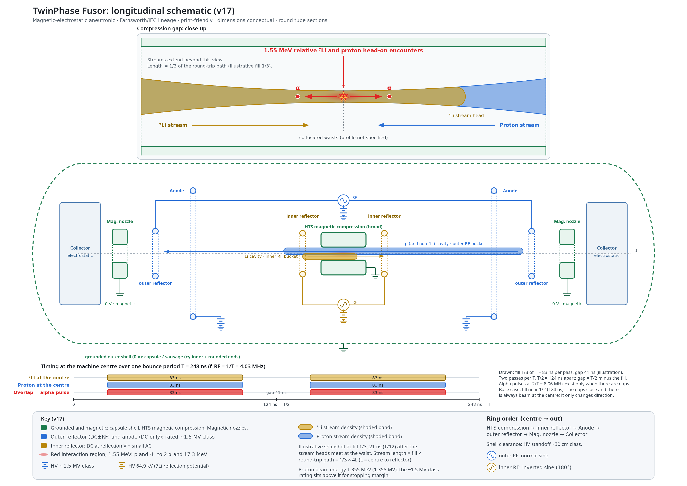
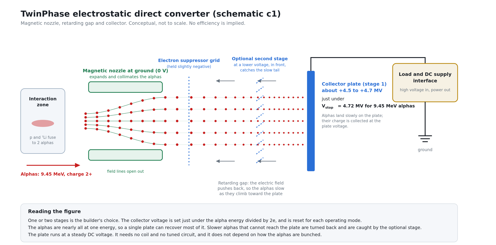

# TwinPhase Resonant Fusor: A Magnetic-Electrostatic Aneutronic Device in the Farnsworth IEC Lineage

**Subtitle:** Nested RF phase buckets for counter-streaming p-⁷Li with grounded-HTS confinement and direct energy conversion

**Author:** Marcus Roberts BE (UNSW)

**Document:** Version X, 2026-11-03

*© 2026 Marcus Roberts. Any use or quotation must credit the author.*

*This work is licensed under the Creative Commons Attribution 4.0 International licence (CC BY 4.0), https://creativecommons.org/licenses/by/4.0/.*

**Project repository:** https://github.com/markrmarkr/twinphase-resonant-fusor

**Archive (Zenodo):** https://doi.org/10.5281/zenodo.23910091 (all versions)

**Status:** This is a conceptual manuscript that sets out an architecture and the design constraints it must meet. Version X takes continuous counter-streaming of long ion streams as its base configuration, with electrostatic direct conversion of the alpha energy. It does not describe a demonstrated net-power device, and it states no gain figure. Quantitative performance claims that remain unclosed are tagged **[OMR-xx]** (Open: modelling required) and catalogued in Appendix A; those tags are retained in the published text wherever modelling is still open.

---

## 1. Abstract

The TwinPhase Resonant Fusor is a conceptual magnetic-electrostatic aneutronic fusion architecture in the Farnsworth-Hirsch inertial electrostatic confinement (IEC) lineage. The device employs nested, anti-phased radio-frequency (RF) phase buckets at a single common drive frequency and 180° relative phase so that protons and fully stripped lithium-7 ions (⁷Li³⁺) counter-stream and meet head-on near a design centre-of-mass (CM) operating point under very high magnetic compression. In the base configuration each species runs as a long stream that fills about half of the 248 ns bounce period, so that beam is always present at the centre and space charge is counted in ions per metre, not ions per packet. The high-temperature superconducting (HTS) magnets used remain at ground potential, while high-voltage electrodes provide electrostatic confinement and RF phase control without carrying coil current. The architecture is within certain constraints, largely fuel-species agnostic, although a p(⁷Li,α)α implementation is presented here. The baseline fusion channel produces two nearly monoenergetic alpha particles, intended for a direct energy conversion (DEC) chain of magnetic nozzle and electrostatic collector. P-⁷Li fusion approaches are often criticised as neutron producing, but TwinPhase is designed around precise control of interaction energies, such that operating points below neutron-producing thresholds can be targeted. The paper describes an architecture intended to achieve this, but importantly acknowledges that there is significantly more work to do before anything useful can be claimed. With this in mind, an open-source approach is taken, based on a structured set of Open Modelling Requirements (OMRs). Absolute dimensions, field magnitudes, self-consistent phase lock under two-body motion, DEC efficiency, and beam-beam and electron-trapping limits are **not** claimed as closed results; they remain catalogued as open modelling items **[OMR-01]**-**[OMR-27]**. The manuscript is an architecture and design-constraint statement suitable as a basis for subsequent modelling and a modest proof-of-concept campaign, not a performance demonstration.

**Keywords:** inertial electrostatic confinement; Farnsworth fusor; aneutronic fusion; p-⁷Li; RF resonant-phase-bunching; direct energy conversion; HTS magnetic confinement

---

## 2. Introduction

Mainstream magnetic-confinement and inertial pathways continue to confront three stubborn challenges: thermalisation of the reacting populations, Bremsstrahlung and other radiation losses that scale unfavourably with temperature and charge, and, where deuterium-tritium (D-T) or deuterium-deuterium (D-D) cycles are used, a neutron inventory that drives shielding mass, material damage, and secondary activation. Classical Farnsworth-Hirsch IEC devices offer geometric simplicity and electrostatic recirculation of ions, yet they have historically struggled with thermalisation of the ion distribution, electrode interception, and the same neutron and radiation penalties when operated on conventional fuels [Farnsworth, 1966; Hirsch, 1967]. Resonant and non-thermal variants of IEC seek to preserve ordered beam-like behaviour long enough for fusion while avoiding the slide into a fully thermal spread of energies. TwinPhase belongs to that family. It is aimed at dissimilar-species fuel, starting with protons and lithium-7.

The closest related work we know of is the Beam Alpha electrostatic fusion collider, which brings proton and lithium-7 beams into head-on collision in an electrostatic trap, and whose prototype is being commissioned [Jackson et al., 2025; Jackson and Bittlingmaier, 2025]. TwinPhase shares the head-on p-⁷Li goal but differs in three respects: the two species, of dissimilar $q/m$, are RF-locked on one axis in nested reflector buckets; the interaction zone is magnetically compressed; and the alpha energy is harvested electrostatically from a continuous alpha stream. More broadly, colliding-beam approaches to aneutronic fuel also include the p-¹¹B colliding beam fusion reactor of Rostoker et al. [1997].

### How TwinPhase works (plain picture)

Think of TwinPhase as two sets of electrostatic “mirrors” sharing one axis, with a strong magnetic squeeze in the middle. Each mirror is a high-voltage electrode that turns ions of one kind back toward the centre, so the ions bounce to and fro along the axis.

**Two reflector sets, one axis.** An *outer-reflector* pair sits farther from the centre and mainly handles protons (and other species with similar or higher charge-to-mass ratios, $q/m$). An *inner-reflector* pair sits closer in and is tuned for lithium-7 ions ($^7\mathrm{Li}^{3+}$, $q/m = 3/7$). Both sets carry the same radio-frequency (RF) drive frequency, but the inner drive is **180° out of phase** with the outer drive. Because bounce time depends on $q/m$ and on how far each species travels between its reflection points, the two species can share one clock while using **different travel distances**: lithium turns around on the short inner path; protons turn around on the longer outer path. Indicatively, the outer reflectors carry a DC bias of about 1.355 MV (the proton energy at the 1.55 MeV working point; the hardware is rated to a ~1.5 MV class for margin) with an RF amplitude of about 50 kV, and the inner reflectors carry about 65-75 kV DC with an RF amplitude of about 5-10 kV, roughly a fifth to a tenth of the outer RF. These figures are a starting point; final values await modelling **[OMR-01]** **[OMR-25]**.

**Streams, not a fog.** The RF does more than bounce ions. It phase-locks each species into a repeating **stream**. Protons form one stream locked to the outer reflectors; $^7\mathrm{Li}$ forms another locked to the inner reflectors. In the base configuration each stream is long: it fills about half of the bounce period $T$ (the time for an ion to go out to its reflector and back, on to the other reflector and back to the centre), so the ions are spread along the axis at low density instead of being squeezed into a short packet. With the 180° phase offset the two streams are steered to meet **head-on** near the midplane rather than co-streaming. At a fill of one half the passes follow one another with no gap, so there is always beam at the centre and it only changes direction.

**Central magnetic compression.** Around that meeting region a grounded high-temperature superconducting (HTS) compression coil produces a finite **interaction zone**: a high-magnetic-field plateau intended to be of order ~2 T class (exact field **[OMR-01]**). The aim is to shrink radial spread so the two streams overlap tightly at their narrowest point, the **waist**, where most of the reactions happen. Fusion products (alphas) are then guided outward, by the same magnetic field, toward grounded magnetic nozzles and an electrostatic collector.

### Contribution, fuel, and scope

The contribution of this work is architectural rather than experimental. TwinPhase combines (i) the nested, phase-locked RF buckets sketched above, so that proton-$^7\mathrm{Li}$ encounters are head-on rather than co-streaming, and (ii) a *grounded core* magnetics layout in which HTS elements remain at chassis ground while high-voltage electrodes are purely electrostatic (± RF) and carry no coil current. The baseline fuel cycle is $p + {}^{7}\mathrm{Li} \rightarrow 2\alpha + 17.3\,\mathrm{MeV}$: a proton fuses with a lithium-7 nucleus to give two alpha particles (helium-4 nuclei) and 17.3 MeV of energy. The machine is specified to run at any collision energy up to the $^7\mathrm{Li}(p,n)^7\mathrm{Be}$ threshold of 1.644 MeV, measured in the centre-of-mass (CM) frame, the frame in which the two colliding ions have zero total momentum. Above that threshold lithium-7 also produces neutrons. Where to sit inside the range is the builder's or operator's choice. A working collision energy of about 1.55 MeV CM is the worked example and design point used for every number in this paper; it leaves about 90 keV of margin below the threshold. The RF frequency is the trim knob: both species share the RF period, so in the uniform-field model changing the frequency moves the collision energy while keeping the total momentum at zero (§8.5). The cross-section, $\sigma$, measures how likely a reaction is per encounter, and it rises with collision energy, so the threshold sets the ceiling on reaction rate for aneutronic running. Optional operating modes (purge; a secondary $p$-$^6\mathrm{Li}$ burn) are outlined later (§8.6) and do not change the baseline picture above.

**Base configuration.** Both species run as long streams that each fill about half of the bounce period $T = 248\,\mathrm{ns}$ (a 0.5 m cavity with a ramp reflector), so that the burn at the centre is continuous (§6.1). A bunched alternative and an interleaved packet train are also noted (§8.6). The exact fill is the builder's choice.

Scope is stated plainly. No net electrical power, no engineering gain $Q_{\mathrm{eng}} > 1$, no gain figure of any kind, and no frozen “optimal” ring spacing or RF frequency are claimed. Real gains must await serious modelling, simulation or experiment. Every unclosed quantitative claim is tagged inline as **[OMR-xx]** and collected in Appendix A. Easy illustrative calculations may be given as illustration without removing the related OMR for full self-consistent modelling. The intended audience is physicists and engineers evaluating whether the topology merits detailed modelling and whether a small proof-of-concept (POC) can test the phase-bucket and reflection-point ideas without pretending to be a power plant.

---

## 3. Collaboration and Attribution

The TwinPhase Resonant Fusor is presented as an open architectural proposal intended to encourage independent analysis, modelling, critique and experimental investigation.

The purpose of this paper is not merely to propose a reactor architecture, but also to identify the principal scientific and engineering questions that must be resolved to determine its viability. To support this objective, unresolved issues are explicitly documented as Open Modelling Requirements (OMRs), providing a structured framework for further investigation.

Researchers, engineers, students and independent contributors are encouraged to examine, challenge, refine or extend the concepts presented herein. Contributions may include analytical work, simulation, modelling, experimental validation, alternative implementations or identification of architectural flaws and limitations.

No claim is made that all major questions have been resolved. Rather, the paper seeks to establish a transparent foundation upon which collaborative progress can occur. The author believes that open technical scrutiny and independent verification provide the most effective path toward determining whether the TwinPhase architecture represents a viable fusion-energy concept.

Commercial exploitation, derivative work and independent implementation are all welcome. Attribution to the original TwinPhase Resonant Fusor architecture is requested where future work materially relies upon or extends concepts presented in this document.

---

## 4. Design principles

Seven principles govern every subsequent section. They are stated here so that later quantitative language cannot be misread as demonstrated performance.

**Principle 1: Prefer grounded superconducting magnetics (early devices).** For early experiments and a possible POC, the HTS coils and other strong magnetic elements sit at ground potential, forming what we call the grounded HTS core. The high-voltage outer-reflector and anode electrodes are purely electrostatic, carrying DC with or without an RF component, and no coil current. This matters because a superconducting coil, with its cryogenics and power feeds, is very hard to float at megavolt potential; keeping it grounded removes that problem entirely. Optional magnetic assistance near the outer-reflector axial station would likewise use separate *grounded* coils. Grounded HTS is a practical starting choice, not an artificial hard constraint on a full-scale plant: later engineering may need to push the envelope (including HV-adjacent magnet options) if modelling and economics demand it.

**Principle 2: Species group by $q/m$.** How an ion moves, and which RF lock captures it, depends only on its charge-to-mass ratio. An RF bucket is the stable region of RF phase in which ions are held together as a packet. TwinPhase uses two such buckets, one nested inside the other and driven in opposite phase, so that protons and ⁷Li³⁺ meet head-on again and again. The worked example below shows why $q/m$ alone decides which bucket an ion joins.

> **Worked example (exact): why bucket occupancy depends only on $q/m$.**
> Newton's second law and the electric force on a charge give
>
> $$ F = ma, \qquad F = qE, \qquad \text{so} \qquad ma = qE, \qquad \text{so} \qquad a = \frac{q}{m}\,E. $$
>
> Here $a$ is acceleration, $q$ the ion charge, $m$ the ion mass and $E$ the local electric field. Two species with the same $q/m$, in the same field, therefore have the same acceleration at every point. Integrating once, from the same starting conditions they have the same velocity at every instant; integrating twice, they have the same position. Their trajectories are identical, so they fall into the same RF bucket. Species with different $q/m$ follow different trajectories and separate.
>
> All species run at the one RF drive frequency. It is not a resonant frequency belonging to each species: $q/m$ only decides which bucket, inner or outer, a species occupies. With proton $=1$ as reference, the TwinPhase groups are $^7\mathrm{Li}^{3+}$ at $3/7\approx 0.431$ (inner bucket), and $^3\mathrm{He}^{2+}$ at $2/3\approx 0.668$ and the half-charge cluster $^4\mathrm{He}^{2+}$/$^6\mathrm{Li}^{3+}$/$\mathrm{D}^{+}$ at $\approx 1/2$ (outer bucket with the protons; Appendix M.1).

**Principle 3: Head-on.** A species which occupies the inner bucket travels in the opposite direction to a species which occupies the outer bucket, because the inner bucket is synchronised by the RF on the inner reflectors, whereas the outer bucket is synchronised by the RF on the outer reflectors, driven 180° out of phase. When both ions move toward each other, both contribute to the collision energy, so for a given relative (CM) energy each needs less laboratory energy than a proton fired at a stationary lithium target would. That lets the proton energy stay at about 1.355 MeV, so a ~1.5 MV class outer reflector is enough, where a proton fired at stationary lithium would need about 1.8 MeV to reach 1.57 MeV. TwinPhase realises that geometry with anti-phased nested cavities (§7). This approach also reduces the spread of energy in the alpha particles produced, which is important to the harvesting stage.

> **Worked example: choosing the proton and lithium energies.**
> TwinPhase sets the two ion energies so that the proton and lithium packets meet with equal and opposite momentum, giving zero total momentum. There are two reasons for this choice.
>
> The first is economy of voltage. In any collision, only the energy of the motion *relative to the centre of mass* can drive the reaction; any energy tied up in moving the centre of mass itself is simply carried along and is unavailable. To see this, write the total momentum as $P = m_p v_p + m_{\mathrm{Li}} v_{\mathrm{Li}}$ (velocities signed along the axis), the total mass as $M = m_p + m_{\mathrm{Li}}$, and the velocity of the centre of mass as $V_{\mathrm{cm}} = P/M$. The total laboratory kinetic energy can always be split into a part belonging to the centre of mass and a part belonging to the relative motion:
>
> $$E_p + E_{\mathrm{Li}} = \tfrac12 M V_{\mathrm{cm}}^{2} + \tfrac12 \mu v_{\mathrm{rel}}^{2} = \frac{P^{2}}{2M} + E_{\mathrm{rel}}.$$
>
> Here $\mu = m_p m_{\mathrm{Li}}/(m_p+m_{\mathrm{Li}})$ is the reduced mass and $v_{\mathrm{rel}}$ the relative speed of the two ions, so the second term is the collision energy $E_{\mathrm{rel}}$. The first term is energy the reflectors must supply but the collision cannot use. For a chosen $E_{\mathrm{rel}}$, the total laboratory energy, and with it the reflector voltage, is therefore smallest when $P = 0$. With zero total momentum the laboratory frame *is* the centre-of-mass frame, every electron-volt the reflectors give the ions is available to the collision, and $E_{\mathrm{rel}} = E_p + E_{\mathrm{Li}}$ exactly. That is what brings the proton energy and accelerating potential down to about 1.355 MeV and 1.355 MV.
>
> The second reason concerns the fusion products. When the colliding pair has zero total momentum, the two alphas must also have zero total momentum, so they leave back to back and, being identical particles, share the available energy equally. Each alpha therefore carries $(Q + E_{\mathrm{rel}})/2 = (17.35 + 1.55)/2 \approx 9.45\,\mathrm{MeV}$, whatever direction it is emitted in. If the pair had a net momentum, the alpha energies would depend on emission angle and would be spread over a band of up to about ±1 MeV for the beam splits considered here (Appendix M.3). A single, known alpha energy is a large advantage for the harvesting stage (§10), whose collector voltage is set by the alpha energy, and it is the reason the alpha energy spread is said above to be reduced.
>
> **Deriving the energies.** Equal and opposite momentum means
>
> $$m_p v_p = m_{\mathrm{Li}} v_{\mathrm{Li}}, \qquad\text{so}\qquad \frac{v_{\mathrm{Li}}}{v_p} = \frac{m_p}{m_{\mathrm{Li}}}.$$
>
> Using the ion masses $m_p = 1.007276\,u$ and $m_{\mathrm{Li}} = 7.014358\,u$ (Wang et al., 2021; Tiesinga et al., 2021), $m_{\mathrm{Li}} = 6.9637\,m_p$, so $v_p = 6.9637\,v_{\mathrm{Li}}$: the proton moves almost seven times faster than the lithium ion. Because the total momentum is zero, the collision energy is simply the sum of the two kinetic energies,
>
> $$E_{\mathrm{rel}} = \tfrac12 m_p v_p^{2} + \tfrac12 m_{\mathrm{Li}} v_{\mathrm{Li}}^{2} = \tfrac12 m_p v_p^{2}\left(1 + \frac{m_p}{m_{\mathrm{Li}}}\right).$$
>
> Setting $E_{\mathrm{rel}} = 1.55\,\mathrm{MeV}$ and solving for $v_p$ gives $v_p = 1.611 \times 10^{7}\,\mathrm{m/s}$ (about 5.4% of the speed of light, so non-relativistic treatment is adequate), and then $v_{\mathrm{Li}} = v_p/6.9637 = 2.314 \times 10^{6}\,\mathrm{m/s}$. The corresponding kinetic energies are
>
> $$E_p = \tfrac12 m_p v_p^{2} = 1.355\,\mathrm{MeV}, \qquad E_{\mathrm{Li}} = \tfrac12 m_{\mathrm{Li}} v_{\mathrm{Li}}^{2} = 0.195\,\mathrm{MeV},$$
>
> which add to 1.55 MeV as required. The proton (charge $e$) gains its energy from a reflector potential $V_p = E_p/e \approx 1.355\,\mathrm{MV}$, and the lithium ion (charge $3e$) from only $V_{\mathrm{Li}} = E_{\mathrm{Li}}/(3e) \approx 64.9\,\mathrm{kV}$. Each species is accelerated by its own reflector set, so no common potential is involved. These are the speeds, energies and voltages used throughout the rest of the paper. Whether the architecture can actually deliver this speed ratio is a separate question, answered by the bounce-period matching condition in §6.
>
> For comparison, a conventional single-well arrangement in which both species fall through one common potential cannot meet with zero momentum, and if run co-streaming it would need about 15 MV to reach 1.55 MeV, far above the 4.72 MV that 9.45 MeV alphas can climb. That case is worked in Appendix M.2 and is rejected. An unequal alternative, with a faster proton and a lower inner reflector potential, is given in §7. These numbers are illustrative voltage *splits* consistent with the locked polarity map; they do not freeze the electrode set **[OMR-02]** **[OMR-03]**.

**Principle 4: Phase restoration as overlap optimisation.** Proton phase lock should be restored faster than it is disrupted:

$$ t_{\mathrm{resync}}^{(p)} < \tau_{\mathrm{disrupt}}^{(p)}. $$

This is a useful design inequality **[OMR-04]**, but it is *not* a viability pass/fail gate. The modelling problem is to keep the two streams crossing inside the compressed high-field zone and to keep a useful overlap efficiency $\eta_{\mathrm{overlap}}$ (the fraction of the two streams' ions that share the meeting volume; §7, §8.2), not to achieve perfect synchronisation. Because each stream is long, a timing offset between the species moves *where* along the axis the streams cross, not *whether* they cross, so the tight timing tolerance of a short-packet design relaxes. Geometry also helps: protons spend most of each cycle in the outer restoring bucket (~tens of cm class) and only briefly transit the short inner-reflector path (Appendix M.5), so outer-bucket restoration can dominate the brief inner disturbance. Several adjustable parameters remain open: RF amplitude and waveform **[OMR-05]**, DC trims, stream populations **[OMR-06]** and bucket depth. Full definitions are given in §8.

**Principle 5: Open modelling tags.** Any absolute dimension, field strength, phase-lock window under two-body kinematics, DEC efficiency, radiation-loss budget, POC parameter set, fuel-ranking metric, or closed-loop fuel-feedback control that is not yet closed by modelling is tagged **[OMR-xx]** in the text and listed in Appendix A. These tags are retained in the published paper wherever modelling is still open. Brief illustrative calculations may appear alongside an OMR without closing or removing it.

**Principle 6: Compact spacing (an option, not a requirement).** Smaller electrode spacing shortens the bounce period and so raises the RF frequency. In the continuous base the beam at the centre never stops, so a higher frequency brings no extra crossings and there is little motivation to push it up; a modest frequency (about 4 MHz for the 0.5 m cavity) is easier engineering and keeps the machine small enough to build. Only in a bunched alternative, where the fusion rate scales with how often packets meet, does compact spacing help the use of a given cross-section. There is also a geometric limit from equal-momentum matching (Appendix M.5): if the outer-reflector half-path is ~30 cm, the matched inner-reflector path is only ~4 cm, so a design that pushes the frequency up will need a careful re-optimisation of the $L_{\mathrm{inner}}/L_p$ and voltage map **[OMR-01]** **[OMR-03]**.

**Principle 7: Stream population.** Reactor performance scales with the numbers of protons and $^7\mathrm{Li}$ ions in the overlap, divided by the area $A$ over which the two streams overlap (Appendix M.6). Space charge limits the number of ions *per metre* of stream (the line density), not the number per packet, so the total inventory can grow with stream length at a fixed line density (§11.1) **[OMR-07]**. The largest line density the focusing can hold, $n_c$, is therefore the central number.

---

## 5. Fuel cycle: p-⁷Li as baseline

The baseline reaction is

$$ p + {}^{7}\mathrm{Li} \rightarrow 2\alpha + 17.35\,\mathrm{MeV}. $$

> **Worked example (exact): $Q$-value and alpha energies.**
> From AME2020 atomic masses [Wang et al., 2021], $Q = \bigl[m(\mathrm{^{1}H})+m(\mathrm{^{7}Li})-2m(\mathrm{^{4}He})\bigr]c^{2} = 17.35\,\mathrm{MeV}$. In the CM frame the two alphas share the released energy $Q$ plus the collision energy $E_{\mathrm{rel}}$ equally, so each carries $(Q+E_{\mathrm{rel}})/2$. For reactants at rest that is $8.67\,\mathrm{MeV}$ each; at the working point $E_{\mathrm{rel}}=1.55\,\mathrm{MeV}$ it is $9.45\,\mathrm{MeV}$ each. For an equal-momentum head-on collision the CM of the reacting pair is at rest, so the laboratory alpha energies equal the CM values (no kinematic spread from CM motion). For unequal beam energies the laboratory collinear extremes spread by $\pm\sim 1\,\mathrm{MeV}$ about that mean (Appendix M.3). An $\alpha^{2+}$ of energy $E_\alpha$ stops electrostatically at $V_{\mathrm{stop}} = E_\alpha/(2e)$, about $4.72\,\mathrm{MV}$ at $9.45\,\mathrm{MeV}$, which sets the voltage of the electrostatic collector in the DEC chain (§10).

> **Worked example (exact): $(p,n)$ threshold: laboratory versus CM.**
> The commonly quoted $^7\mathrm{Li}(p,n)^7\mathrm{Be}$ threshold $E_{\mathrm{thr}}^{\mathrm{lab}} \approx 1.880\,\mathrm{MeV}$ is the **laboratory** proton energy on *stationary* $^7\mathrm{Li}$ [White et al., 1985; Wang et al., 2021]. The corresponding relative (CM) energy is

> $$ E_{\mathrm{thr}}^{\mathrm{CM}} = E_{\mathrm{thr}}^{\mathrm{lab}}\frac{m_{\mathrm{Li}}}{m_p+m_{\mathrm{Li}}} \approx 1.644\,\mathrm{MeV}. $$

> Aneutronic operation therefore needs $E_{\mathrm{rel}} < 1.644\,\mathrm{MeV}$, with some margin because the RF spreads the ion energies a little (a continuous stream fills about half of an RF bucket, so its energy spread depends on the RF amplitude **[OMR-25]**). In practice the operator sets the point far enough below threshold that the upper tail of the energy spread stays under it, and uses the neutron count rate as the guardrail (§8.5). Alternatively, a set-point above threshold needs an explicit neutron budget. An illustrative sub-threshold point is $E_{\mathrm{rel}} \approx 1.55\,\mathrm{MeV}$, which leaves a margin of about $90\,\mathrm{keV}$ in the CM frame. If the two ions carry equal and opposite momenta, this point needs a proton reflector voltage of $V_p \approx 1.355\,\mathrm{MV}$ and a lithium reflector voltage of $V_{\mathrm{Li}} \approx 64.9\,\mathrm{kV}$. The proton energy and accelerating potential are this 1.355 MV working figure, and the outer-reflector and anode hardware in §6 is rated to a ~1.5 MV class, above it so that the reflector stops protons with margin. Closing the operating window is **[OMR-02]**.

The $^7\mathrm{Li}(p,\alpha)\alpha$ cross-section near $1.55\,\mathrm{MeV}$ CM is taken as about $15\,\mathrm{mb}$ (evaluated and direct data span roughly $14$ to $17\,\mathrm{mb}$) [Brown et al., 2018]. It continues to rise through and beyond the $(p,n)$ threshold, so a machine held below threshold accepts a lower cross-section than the peak, as radiological discipline **[OMR-02]**.

For TwinPhase specifically, ⁷Li is attractive before any nuclear $Q$-value comparison with boron. Fully stripped ⁷Li³⁺ has $q/m = 3/7 \approx 0.431$, which sits cleanly apart from protons ($q/m = 1$) and from the half-charge ash/impurity group ($q/m = 1/2$: ⁴He²⁺, ⁶Li³⁺, D⁺) and ³He²⁺ ($q/m = 2/3$). Magnetically, $Z=3$ is substantially kinder than fully stripped ¹¹B⁵⁺ ($Z=5$) for a grounded-HTS architecture at modest field ($Z^{2}$ ratio $25/9 \approx 2.8$; §11, §15). Two alpha products are also kinder to a magnetic-nozzle plus electrostatic collector than the dissimilar-energy, three-body product split of p-¹¹B. The full architectural fuel comparison is given in §15.

**Lithium isotopic purity and the $^6\mathrm{Li}$ channel.** Natural lithium is $7.59\,\%$ $^6\mathrm{Li}$ by mole fraction [Coursey et al. / NIST-IUPAC]. Fully stripped $^6\mathrm{Li}^{3+}$ has $q/m \approx 1/2$ ($0.503$ relative to the proton), the same group as $^4\mathrm{He}^{2+}$ and $\mathrm{D}^{+}$. Under the high-voltage settings used to burn $^7\mathrm{Li}$, it is therefore captured by the outer bucket along with the protons, rather than by the inner reflector. There it pays the continual RF energy cost that all outer-bucket ions pay (the RF tax, §6.2), so it has to be managed (§8.6, §11).

Where $^6\mathrm{Li}$ meets a proton it burns by

$$ p + {}^{6}\mathrm{Li} \rightarrow {}^{3}\mathrm{He} + {}^{4}\mathrm{He} + 4.02\,\mathrm{MeV}. $$

In the CM (reactants at rest, or equal-momentum head-on) the energy split is $E({}^{3}\mathrm{He}) = 2.29\,\mathrm{MeV}$ and $E({}^{4}\mathrm{He}) = 1.73\,\mathrm{MeV}$ (Appendix M.9). Whether these products can leave the device depends on the outer reflector, which acts as an energy barrier of height $E_{\mathrm{clear}} = qV_{\mathrm{outer}}$, where $q$ is the product's charge and $V_{\mathrm{outer}}$ the outer-reflector voltage. Two cases follow:
- at the $^7\mathrm{Li}$-burn working point $V_{\mathrm{outer}}\approx 1.355$-$1.5\,\mathrm{MV}$ ($E_{\mathrm{clear}}=2.7$-$3.0\,\mathrm{MeV}$ for $q=2e$), *neither* product clears; both are trapped in the outer bucket as ash;
- both clear if $V_{\mathrm{outer}} \lesssim 0.86\,\mathrm{MV}$ (set by the slower $^4\mathrm{He}$), which is the basis of the dedicated $^6\mathrm{Li}$-burn mode in §8.6.

Natural lithium is therefore acceptable for early prototypes and for a plant that time-shares a Mode-3 burn; enriched $^7\mathrm{Li}$ ($\geq 99.9\,\%$) is optional and already an industrial product, since pressurised-water reactors use it at $99.99\,\%$ in coolant chemistry [GAO, 2013].

**Hard-$\gamma$ rays, not neutrons.** A proton can be captured by lithium and give off a hard $\gamma$ instead of fusing. For $^7\mathrm{Li}$ that capture is stronger near $441\,\mathrm{keV}$ and $1030\,\mathrm{keV}$, the laboratory energies of resonances in $^8\mathrm{Be}$ [Ajzenberg-Selove, 1988]. In Mode 1 the proton energy is about $1.36\,\mathrm{MeV}$, above both, so the ions only pass through those energies and the $\gamma$ yield should be small. In Mode 3 the outer voltage is about $0.85\,\mathrm{MV}$, between the two resonances, and leftover $^7\mathrm{Li}$ can still meet protons, so that yield has to be managed; Mode 2 is the same question until the purge voltage is chosen, and below $441\,\mathrm{keV}$ the channel goes quiet. This is a radiological side channel, not a neutron-threshold issue **[OMR-09]**. A claimed $^6\mathrm{Li}$ capture resonance near $195\,\mathrm{keV}$ was not confirmed [Piatti et al., 2020], and $195\,\mathrm{keV}$ is below every operating mode.

Illustrative reaction energetics and operating-point labels in this section are nuclear-physics context. They are not a claim that the TwinPhase voltage set (a 1.355 MV proton energy on a ~1.5 MV class outer-reflector/anode) already places both beams on a frozen aneutronic operating point under head-on kinematics; that placement is **[OMR-02]** and **[OMR-03]**.

---

## 6. System architecture: TwinPhase topology

### 6.1 Longitudinal layout (centre → out)

The locked architecture, symmetric about the midplane, is as follows from centre outward:

1. **HTS compression ring**: 0 V, magnetic, grounded. This is the grounded HTS core: magnetic compression and radial confinement without placing superconductors at high voltage.
2. **Inner-reflector ring**: a DC bias at the potential where ⁷Li turns around, plus a small AC component at the same frequency as the outer-reflector RF but 180° out of phase. There is no HTS on this ring. Its job is to phase-lock ⁷Li³⁺.
3. **Anode**: a large-radius, non-magnetic electrode rated to a ~1.5 MV class at DC (the proton energy is 1.355 MV), with no RF, providing electrostatic confinement only. The anode sets the deep electrostatic well without adding RF phase structure.
4. **Outer reflector**: rated to a ~1.5 MV class at DC, above the 1.355 MV proton energy so that it stops protons with margin, with an RF component on top, so it is both an electrostatic and an RF electrode. No coils are mounted on this high-voltage electrode. The outer-reflector AC phase-locks protons and other non-⁷Li species into the outer bucket.
5. **Magnetic nozzle**: 0 V, magnetic, grounded; expands and collimates alpha exhaust toward the collector.
6. **Electrostatic collector**: beyond the nozzle, a separate high-voltage plate (about 4.72 MV for the worked example, §10) at which the alphas are slowed and collected.

*Figure 6.1. TwinPhase Fusor longitudinal schematic (conceptual; dimensions TBD), drawn at a fill of 1/3 as an illustration; the base case is a fill near 1/2, where the gaps close. Centreline from HTS compression through inner reflector ring, anode, outer reflector, magnetic nozzle, and collector. The grounded outer shell is a capsule with illustrative HV standoff clearance (~30 cm class). The head-on interaction region is a finite axial zone under the broad compression coil. The proton reflection-point inset and the ⁷Li reflection on the inner rings (§6.2) are marked. The timing strip shows the two fill windows over one 248 ns bounce period.*

Absolute axial lengths, inner-reflector length $L_{\mathrm{inner}}$, radial standoffs, and B-field magnitudes are not frozen here **[OMR-01]**.

**Streams, fill and the 248 ns period.** In the base configuration each species is a long stream, not a short packet. The bounce period $T$ is the time for an ion to go from the centre to its reflection point and back, on to the other reflection point and back to the centre. With a ramp reflector (a uniform decelerating field; Appendix M.5) the 0.5 m proton cavity gives $T = 248\,\mathrm{ns}$ and an RF frequency $f_{\mathrm{RF}} = 1/T = 4.03\,\mathrm{MHz}$. Each stream crosses the centre twice per $T$, once each way, so passes are $T/2 = 124\,\mathrm{ns}$ apart. The *fill* is the share of $T$ that a stream takes to pass the centre. At a fill of 1/2 (124 ns) each pass starts as the previous one ends, so there is always beam at the centre and it only changes direction. This continuous limit is the base case. At a fill of 1/3 (83 ns) there is a gap of 41 ns between passes and the alpha output arrives in pulses at $2/T = 8.06\,\mathrm{MHz}$; Figure 6.1 draws this bunched case as an illustration, because separate bands are easier to read.

**Where the streams cross.** Protons feel *both* RF waveforms, so the whole proton stream can arrive slightly early or late. Because the streams are long, this moves *where* along the axis they cross, not whether they cross. That is tolerable because a broad HTS compression coil gives a high-field plateau of finite length rather than a sharp peak at the midplane: provided the crossing stays inside the plateau, head-on p-⁷Li encounters still occur in the high-compression zone. The crossing can be trimmed with the proton RF phase advance (§12), held at its optimum by dither feedback on the collector current. The relationship between plateau half-length and timing offset is part of **[OMR-01]** / **[OMR-03]**.

### 6.2 Nested RF buckets

The outer RF bucket is driven by outer-reflector AC. It phase-locks protons and non-⁷Li species (including the $q/m = 1/2$ and $q/m = 2/3$ groups; see §8.1). The inner RF bucket is driven by inner-reflector AC at the *same* frequency and 180° relative phase, phase-locking ⁷Li³⁺ only. Because the buckets are anti-phased, the locked populations repeatedly meet head-on near the interaction region rather than chasing one another in co-stream.

> **Worked example (exact): nested-bucket matching condition.**
> Let $T_s = \oint \mathrm{d}z/v_s(z)$ be the bounce period of species $s$ in the electrostatic (RF-averaged) potential. Architecture requires a single RF frequency and anti-phase lock:

> $$ T_p(L_p,V_{\mathrm{outer}},q/m{=}1) = T_{\mathrm{Li}}(L_{\mathrm{inner}},V_{\mathrm{Li\text{-}cavity}},q/m{=}3/7) = 1/f_{\mathrm{RF}}, $$

> $$ \phi_{\mathrm{Li}}(t) = \phi_p(t) + \pi. $$

> Each species gains speed $v = \sqrt{2qV/m}$ falling through its reflection potential $V$, and the bounce period is path length over speed, so in similar wells $T \propto L/v = L\sqrt{m/(qV_{\mathrm{eff}})}$. This is where the architecture has to deliver the speeds derived in §5. With a ramp reflector each species crosses its half-path four times per bounce at an average speed of $v/2$, so $T = 8L/v$ (Appendix M.5), and equal periods $T_p = T_{\mathrm{Li}}$ require
>
> $$\frac{v_p}{v_{\mathrm{Li}}} = \frac{L_p}{L_{\mathrm{inner}}}.$$
>
> The architecture therefore fixes the speed ratio through the geometry, with $X = L_p/L_{\mathrm{inner}}$. Zero total momentum (§5) independently demands $v_p/v_{\mathrm{Li}} = m_{\mathrm{Li}}/m_p = 6.9637$. The two agree only if the geometry is built to match, $L_{\mathrm{inner}}/L_p = m_p/m_{\mathrm{Li}} \approx 0.144$; equivalently, the equal-momentum voltages ($V_p \approx 1.355\,\mathrm{MV}$, $V_{\mathrm{Li}} \approx 64.9\,\mathrm{kV}$) and the common RF period together fix that ratio (Appendix M.5). This is a design condition, not something the architecture does automatically. If the built ratio differs, the RF lock still forces equal periods, so the speeds follow the geometry, the momenta no longer cancel, and the alpha energies spread. The ratio $m_p/m_{\mathrm{Li}}$ holds for any well shape common to both species, but a real well is not an ideal ramp, so the true ratio carries a shape factor that must come from the full potential map, and the DC potentials remain available as fine trims to restore the match. Absolute lengths remain **[OMR-01]**.

By design, protons barely notice the DC bias on the lithium rings: their reflection points and outer-bucket dynamics are set by the outer reflector and anode potentials. The small inner-reflector AC is a controlled perturbation on the proton orbit, enough to share the timing structure without destroying outer-bucket lock, while remaining the dominant phase handle for ⁷Li. Perturbation amplitudes, proton arrival jitter and waveform options that open a low-field transit window are **[OMR-04]** **[OMR-05]**.

Unlike a design in which each species coasts once locked until a collision, TwinPhase protons are continuously accelerated and decelerated each RF cycle by the dual-waveform environment. That ongoing RF work is an efficiency tax inherent to the nested-bucket mechanism and may need to be carried in later wall-plug accounting.

**Fold-over at the reflectors.** Near a fill of 1/2 the stream is as long as the time between passes, so at its turning point the tail is still arriving while the head is already returning. The stream folds over itself and the density there is up to double the mid-path density, so the reflector inset (§6.3) and the space-charge budget (§11.1) are set at the turning points.

### 6.3 Reflection points

We use one fixed definition throughout: a **reflection point** is the position along the axis where the ion’s kinetic energy in the electrostatic potential satisfies $E = V$ and the axial velocity $v_z \to 0$ before reversal.

The **proton** reflection point is inset inside the outer-reflector rings, providing leak margin against escape into the magnetic nozzle and collector path during RF phase excursions. By contrast, **⁷Li** reflects on the inner-reflector rings (the inner bucket) by design: a different geometry, not the same inset rule applied to both species. Treating both species as identically inset would erase the nested-bucket distinction TwinPhase relies upon. Near a fill of 1/2 the inset must also leave room for the density rise at the turning point (§6.2).

### 6.4 Magnet map

| Element | Magnetic? | Notes |
|---|---|---|
| HTS compression | Yes (HTS) | Grounded HTS core |
| Nozzles | Yes | Required for alpha collimation |
| Anodes | No | Pure electrostatic |
| Outer-reflector *electrodes* | No | Optional later: separate *grounded* coils near reflector $z$ if loss cones demand |
| Inner-reflector rings | No HTS; fringe/Cu optional | HV + AC environment |

The grounded outer shell completes the HV return. Outer-reflector electrodes remain non-magnetic; any future magnetic assistance at outer reflector $z$ is a grounded add-on, not a coil on the megavolt hardware.

The plateau length is the builder's choice. A 2 T solenoid holds a stream narrow only up to the equilibrium line density $n_B$ (the Brillouin limit), so a longer plateau helps only if the density can be held at that value (§11.1).

**Interaction zone (magnetic).** Under the compression ring the high-$B$ region is a *finite axial plateau*, not a mathematical midplane spike (§6.1). Useful interaction needs strong *radial* compression, so that the two beams share a narrow envelope at high density, and enough *axial* bandwidth that protons and $^7\mathrm{Li}$ still meet inside the plateau while $\sigma$ is high. A timing offset that moves the crossing off the plateau, or a radial mismatch that leaves most ions outside the compressed core, would cut the reaction rate sharply even with the voltages set correctly **[OMR-01]** **[OMR-04]** **[OMR-06]**.

### 6.5 Figure intent and open geometry

Figure 6.1 shows the arrangement of components, not their sizes, and is drawn at a fill of 1/3 for legibility (the base fill near 1/2 closes the gaps). Publication-quality figures will carry scale bars only after **[OMR-01]** closes absolute dimensions, $L_{\mathrm{inner}}$, radial standoffs, and B-field magnitudes. Until then, schematics are not dimensioned manufacturing drawings.

The RF frequency is not a free parameter to be chosen as optimal. It follows from the geometry and the required bounce timing once the lengths are fixed. Ring spacings, AC amplitudes, and B magnitudes await **[OMR-01]** and the overlap / phase-restoration modelling of **[OMR-04]** **[OMR-05]**. The grounded outer shell is the HV return; optional grounded coils near the outer reflector $z$ remain a later loss-cone contingency, never windings on the HV outer reflector electrode itself.

---

## 7. Kinematics: why TwinPhase (head-on)

In a stationary-target picture, a proton fired at lithium at rest must carry a laboratory energy $E_{\mathrm{lab}} = E_{\mathrm{rel}}(m_p+m_{\mathrm{Li}})/m_{\mathrm{Li}} \approx (8/7)E_{\mathrm{rel}}$ to reach a relative energy $E_{\mathrm{rel}}$, where $m_p$ and $m_{\mathrm{Li}}$ are the proton and lithium masses. In head-on counter-streaming, by contrast, both species move and both contribute kinetic energy toward $E_{\mathrm{rel}}$. TwinPhase realises that geometry with nested anti-phased RF buckets so that $v_{\mathrm{rel}} = v_p + v_{\mathrm{Li}}$.

> **Worked example (exact): how voltages set $E_{\mathrm{rel}}$.**
> Non-relativistically, $E_{\mathrm{rel}} = \tfrac{1}{2}\mu(v_p + v_{\mathrm{Li}})^{2}$ for head-on encounters, with $\mu = m_p m_{\mathrm{Li}}/(m_p+m_{\mathrm{Li}})$, and $v = \sqrt{2qV/m}$ when each species is accelerated from rest through its reflection potential. If both species instead fell through one shared potential $V$, head-on operation would give $E_{\mathrm{rel}} = 2.399 \times V$, with $E_{\mathrm{rel}}$ in MeV and $V$ in MV (for example, $V = 0.646\,\mathrm{MV}$ gives $E_{\mathrm{rel}} = 1.55\,\mathrm{MeV}$; derivation in §4 and Appendix M.2). TwinPhase uses *independent* reflection potentials: outer-reflector/anode class for protons, inner reflector DC bias for $^7\mathrm{Li}^{3+}$.

> **Worked example (illustrative): architecture-consistent voltage pair.**
> Take a slow lithium beam, with the $^7\mathrm{Li}^{3+}$ reflection potential at $V_{\mathrm{Li}} \approx 20\,\mathrm{kV}$ ($E_{\mathrm{Li}} \approx 0.060\,\mathrm{MeV}$), and choose the proton energy so that head-on $E_{\mathrm{rel}} = 1.55\,\mathrm{MeV}$. Then $E_p \approx 1.53\,\mathrm{MeV}$ and $V_p \approx 1.53\,\mathrm{MV}$. (The proton alone, hitting stationary lithium, would supply $1.53 \times 7/8 \approx 1.34\,\mathrm{MeV}$ of relative energy; the slow lithium supplies the remaining $\approx 0.21\,\mathrm{MeV}$ because its speed adds to the closing speed.) Note that a proton at 1.80 MeV would give at least $1.80 \times 7/8 \approx 1.57\,\mathrm{MeV}$ even with stationary lithium, already above the working point, so the proton reflector has to sit below 1.80 MV. The equal-momentum alternative ($V_p \approx 1.355\,\mathrm{MV}$, $V_{\mathrm{Li}} \approx 64.9\,\mathrm{kV}$) brings the centre of mass of the reacting pair to rest and so minimises the spread of alpha energies in the laboratory (§5). Self-consistent nested-RF trajectories remain **[OMR-03]**; §6 anode/inner reflector numbers stay illustrative pending the known potential-map revision.

Until the velocity pair is closed under nested RF, the 1.355 MV proton energy and ~1.5 MV class rating in §6 should be read as the design-point voltage and electrode polarity map, not as a verified phase-lock set-point **[OMR-02]** **[OMR-03]**.

Head-on geometry also changes the usual distinction between beam-target and beam-beam operation. TwinPhase is deliberately a beam-beam device: two beams of different species, with locked phases, collide with each other. The classical IEC picture, in which a beam collides with a background gas, is not the operating concept here.

**Timing and overlap.** Define the overlap efficiency $\eta_{\mathrm{overlap}}$ as the fraction of the two streams' ions that share the meeting volume. It is set mainly by how well the radial widths of the two streams match at the waist. Timing matters less than for short packets: an offset moves where the streams cross, not whether they do (§4), so its effect on the rate is a single factor, the share of the crossing that falls inside the compression plateau. Closing $\eta_{\mathrm{overlap}}$ under space charge and beam shaping is **[OMR-04]** **[OMR-06]**; waveform levers that reduce proton perturbation during transit are **[OMR-05]** (Appendix M.6).

---

## 8. Resonance, synchronisation, and the phase-restoration constraint

### 8.1 Species groups by $q/m$

| Group | $q/m$ | Role |
|---|---|---|
| ¹H⁺ | 1 | Outer bucket; lightest; most vulnerable in the inner zone |
| ⁴He²⁺, ⁶Li³⁺, D⁺ | 1/2 | Outer bucket; ash/impurity priority #2 |
| ³He²⁺ | 2/3 | Outer bucket |
| ⁷Li³⁺ | 3/7 | Inner bucket; high dwell; easier lock |

The outer-reflector AC is responsible for locking the $q/m = 1$, $1/2$, and $2/3$ populations. The inner-reflector AC locks $q/m = 3/7$. Clean separation of ⁷Li from protons and other $q/m \geq 0.5$ groups is exactly why $q/m = 3/7$ is architecturally valuable (§15). That is, ⁷Li³⁺ has $q/m \approx 0.431$, whereas ¹¹B⁵⁺ has $q/m = 5/11 \approx 0.455$, closer to the $0.5$ group. This difference makes ⁷Li much more workable with the TwinPhase architecture.

### 8.2 Phase restoration and overlap loss (not a pass/fail gate)

Protons are the lightest species and live in the outer bucket. They spend only a short time in the inner zone, but while they are there they are the most exposed to disturbance: collisions, errors in RF phase and amplitude (including the inner-reflector drive acting on them as they pass), and space charge. TwinPhase therefore asks that the time to restore proton phase lock after a disruption-scale kick be shorter than the mean time between such disruptions:

$$ t_{\mathrm{resync}}^{(p)} < \tau_{\mathrm{disrupt}}^{(p)}. $$

Here $t_{\mathrm{resync}}^{(p)}$ is set by the brief inner dwell of the proton orbit together with the number $N_{\mathrm{kick}}$ of outer-reflector restorations (RF bucket kicks) needed to re-establish resonant-phase-bunching, while $\tau_{\mathrm{disrupt}}^{(p)}$ is the characteristic disruption time from Coulomb scattering, two-stream coupling, and related processes at the operating density.

**Framing.** We treat the inequality as a target to optimise against overlap loss, not as a pass or fail test of the architecture **[OMR-04]**. What matters is that the two streams keep crossing inside the compressed zone and that $\eta_{\mathrm{overlap}}$ (§7) stays useful, not that every proton stay in perfect sync. Geometry tips the balance toward restoration: protons spend most of each cycle in the long outer restoring bucket and only briefly transit the short inner-reflector path (Appendix M.5), so the restoring kicks in the outer bucket can outweigh the brief disturbance in the inner zone.

**Knobs.** The outer-reflector AC amplitude is the first: stronger kicks restore the lock in fewer kicks (smaller $N_{\mathrm{kick}}$), at a cost in RF power and voltage. Others are the DC trims, the bucket depth, and the inventory ratio $n_p:n_{\mathrm{Li}}$, the number of protons held per lithium ion, which shapes the beams so that their radial widths match **[OMR-06]**. The inner-reflector waveform need not be sinusoidal **[OMR-05]**: a shaped waveform could leave a low-field window while protons pass, at the price of harder RF engineering. Working out the densities, $\eta_{\mathrm{overlap}}$, the effective cross-section $\sigma_{\mathrm{eff}}$ and $N_{\mathrm{kick}}(V_{\mathrm{AC}})$ consistently is **[OMR-04]**. The same inequality applied to the $q/m = 1/2$ group (alphas before they reach the nozzles, ⁶Li and D) and to ³He ($q/m = 2/3$), which share the outer bucket with the protons, is **[OMR-10]**: each must be kept in step, steered to the nozzles or purged before build-up spoils proton lock.

**The slip factor and long streams.** The slip factor $\eta$ says how the bounce period changes with an ion's energy, $\eta = (\Delta T/T)/(\Delta E/E)$, where $\Delta T$ and $\Delta E$ are the departures of an off-energy ion from the design period $T$ and design energy $E$. It is set by the shape of the reflector field (a linear ramp gives $\eta = +1/2$, while a reflector with steeper walls would push $\eta$ negative; Appendix M.7), and it decides whether the RF bunches a stream or leaves it alone. Its sign and size are the builder's choice, and this paper chooses none. The three regimes are:

- **$\eta$ positive** (the nominal ramp): the RF restoring force pulls ions toward the stable phase, so a long stream tends to collapse toward a single bunch over a few oscillations of its energy, which also grows the energy spread. Keeping it long needs a weak RF or a flattened RF waveform.
- **$\eta$ near zero:** the period barely depends on energy, so ions hold the phase they are given and a stream stays long without help, but the RF has little grip on energy errors, so the spread has to be controlled another way.
- **$\eta$ negative:** the stable phase moves to the opposite RF slope and a stream tends to spread rather than clump, so a waveform template can be used to shape the fill.

The effect on energy spread against the neutron margin is **[OMR-25]**, and the choice is recorded as **[OMR-24]**.

### 8.3 Synchronisation picture

Once locked, the ⁷Li oscillates in the inner bucket and spends a large fraction of its time near the interaction region. The protons, meanwhile, return from their inset reflection points on a schedule that brings the proton stream through the midplane region in anti-phase with the turning lithium. Because protons see both RF waveforms, the whole proton stream can arrive slightly early or late, which moves where the two streams cross, not whether they cross; under a broad compression coil that offset is intended to stay inside the high-field plateau (§6.1). The offset is tied to where the reflection points sit (§6.3) and to the RF phase, and it can be trimmed with the proton RF phase advance under dither feedback on the collector current (§12). The frequency itself follows from the bounce times once the geometry is fixed **[OMR-01]**.

> **Worked example (illustrative): bounce period and RF band.**
> Absolute lengths are not frozen. For a proton half-path $L_p = 0.5\,\mathrm{m}$ at $V_p = 1.355\,\mathrm{MV}$ ($v_p \approx 1.61\times 10^{7}\,\mathrm{m\,s^{-1}}$), a ramp reflector gives $T_p \approx 8L_p/v_p \approx 248\,\mathrm{ns}$ ($f_p \approx 4.03\,\mathrm{MHz}$). Matching $T_{\mathrm{Li}}=T_p$ at the equal-momentum Li voltage ($\approx 64.9\,\mathrm{kV}$) requires $L_{\mathrm{inner}} = L_p\,m_p/m_{\mathrm{Li}} \approx 0.072\,\mathrm{m}$. The RF band is **multi-MHz** for metre-class hardware, scaling as $f \propto L^{-1}\sqrt{qV/m}$. These figures illustrate scaling only; the frozen geometry is **[OMR-01]**, and sinusoidal versus shaped waveforms are **[OMR-04]** **[OMR-05]** (Appendix M.4-M.5).

### 8.4 Single-drive option: inner RF only

The outer-reflector RF may not be essential. Protons pass through the inner reflectors on every bounce, and their bucket is half an RF cycle out of step with the ⁷Li bucket. The inner drive, run 180° out of phase for lithium, may therefore also act in the correct phase to bunch the protons, so a single RF supply could hold both species in phase lock. Against this, the inner AC amplitude is small (about 5-10 kV) and acts on the protons where they are fast, far from their reflection point, so the proton lock may be weak. Raising the inner amplitude to compensate would also disturb the lithium bucket. Whether a single inner drive can hold both buckets, and with what amplitude, is **[OMR-11]**. If it works, the outer reflectors need DC only, removing one megavolt-class RF supply.

### 8.5 Operating-point control and feedback

The operating point does not have to be predicted exactly. A first-order model (Appendix M) places the device near its intended relative energy, and closed-loop feedback then trims it onto the set-point using measured signatures, which relaxes the precision required of **[OMR-02]** and **[OMR-03]**. Modelling must show that the loop has the correct sign, sufficient actuator authority and adequate bandwidth, not that the set-point is hit open-loop to a few keV.

**Sensors.** The table lists the signals the loop can use, what each one tells us, and how it enters the control.

| Signal | What it indicates | Use in the loop |
|---|---|---|
| Neutron count rate | Upper tail of the $E_{\mathrm{rel}}$ distribution crossing $E_{\mathrm{thr}}^{\mathrm{CM}} \approx 1.644\,\mathrm{MeV}$ | Primary upper-limit sensor; doubles as the aneutronic guardrail (§9) |
| Alpha yield / collector current | Fusion rate (overlap, density, $E_{\mathrm{rel}}$); a steady current in the continuous base | Maximise subject to the neutron limit |
| X-ray (Bremsstrahlung) level | Residual electron population $n_e$ (§11) | Flags electron accumulation |
| Ash / inventory proxies (prefer non-optical in the core; see note) | Outer-bucket ash inventory | Triggers purge (§11) |
| RF drive requires excessive power | Build-up of non-participating species | Triggers purge or ⁶Li burn |

**Optical caveat.** Visible light from helium is normally produced when electrons collide with it, so in an electron-depleted core that emission is weak and is a poor main diagnostic for ash on the axis. Prefer neutrons, collector / alpha current, and X-ray level for the core loop. The size of the RF tax from the $q/m \approx 1/2$ group and ³He ($q/m \approx 2/3$) measures how much ash has built up, so it can be used to tell when a purge is due.

The neutron signal is unusually well suited to the role of an upper-limit sensor. The $^7\mathrm{Li}(p,n)^7\mathrm{Be}$ cross-section is zero below threshold and rises to about $270\,\mathrm{mb}$ within $50\,\mathrm{keV}$ (laboratory) of it [Lee and Zhou, 1999], within about $44\,\mathrm{keV}$ in CM terms, and more than an order of magnitude above the $p$-$^7\mathrm{Li} \rightarrow 2\alpha$ cross-section in the same range (§5). A rising neutron count is therefore a direct, sensitive and one-sided indicator that the high-energy tail has crossed threshold.

**Actuators.** Three controls act on the operating point. The RF frequency $f_{\mathrm{RF}}$ gives a fine trim of where the reflection points sit, and hence of the collision energy. The DC trims on the outer reflector and the inner-reflector bias set the energy and reflection points coarsely. The RF amplitude sets the bucket height, and hence how much energy spread the bucket accepts.

**Assumption: fairly uniform axial field.** The control law below rests on one assumption: with ring electrodes of similar shape, the electrostatic field along each species' path is fairly uniform, so the DC bias (~1.355 MV, inside the ~1.5 MV class rating) supplies nearly all of the accelerating force while the AC (~50 kV class on the outer reflector; **[OMR-25]**) mainly synchronises phase lock. Species phase-lock to the AC on their own reflectors, $^7\mathrm{Li}^{3+}$ on the inner-reflector rings and protons and the other $q/m$ groups on the outer reflector, so the RF frequency sets the *locations* of those reflection points.

**Nominal control law.** Raising $f_{\mathrm{RF}}$ moves the locked reflection points inward toward the compression region. The swing shortens, the voltage drop from reflection point to centre falls, and the kinetic (interaction) energy at centre falls with it: $\mathrm{d}E/\mathrm{d}f < 0$ under the uniform-field assumption (Appendix M.7). The nominal loop is therefore one-sided and simple:

- neutron rate above set-point $\rightarrow$ *increase* frequency (fine trim of $E_{\mathrm{rel}}$ downward);
- neutron rate well below set-point with healthy alpha yield $\rightarrow$ *decrease* frequency, or raise DC trim, subject to reflection-point placement constraints.

Large frequency changes are limited by the geometry. $^7\mathrm{Li}$ reflection must remain near the inner-reflector rings, and proton reflection must remain inset inside the outer-reflector rings (§6.3). Outside that band the nested matching condition of §6.2 fails and the loop hands off to DC trim. Frequency alone is enough to trim the collision energy because both species lock to the same RF period. In the uniform-field model each species' momentum then scales as $1/f$ by the same factor, so the equal-momentum condition is preserved as $f$ changes, and $E_{\mathrm{rel}}$ follows the general trim law $\mathrm{d}\ln E/\mathrm{d}\ln f = -1/\eta$ (Appendix M.7), with $\eta$ the slip factor of §8.2. For the uniform-field (linear ramp) case $\eta = +1/2$, so $E_{\mathrm{rel}}$ scales as $f^{-2}$: a $1\,\%$ rise in $f$ lowers $E_{\mathrm{rel}}$ by about $2\,\%$, or about $31\,\mathrm{keV}$ at $1.55\,\mathrm{MeV}$.

> **Worked example (illustrative): neutron-limited loop.**
> Neutron rate rises above set-point. Under the nominal law, raise $f_{\mathrm{RF}}$ so that the proton and $^7\mathrm{Li}$ reflection points move inward, shortening each swing and lowering $E_{\mathrm{rel}}$. For a $50\,\mathrm{keV}$ downward trim at the sub-threshold equal-momentum point ($E_{\mathrm{rel}} = 1.55\,\mathrm{MeV}$, $E_p = 1.355\,\mathrm{MeV}$) the required $\delta E_p = -50\,\mathrm{keV}$ ($\delta\ln E_p = -3.7\,\%$) corresponds, in a uniform-field / linear-ramp estimate ($\mathrm{d}\ln E/\mathrm{d}\ln f = -1/\eta = -2$), to a frequency *increase* of about $1.8\,\%$, well inside a fine-trim band that keeps $^7\mathrm{Li}$ near the inner-reflector rings and protons inset inside the outer reflector. Larger corrections are made by DC trim, not by pushing frequency against those placement limits. A commissioning nudge of $f_{\mathrm{RF}}$ with synchronous observation of the neutron (and alpha) rate remains a safety check that the built potential map has not inverted the expected sign **[OMR-12]**; it is not the primary control narrative.

A reflector with steeper walls would reverse the trim direction; that is the builder's choice (Appendix M.7). How fast the loop can respond is limited in two ways: it must be faster than the drifts it corrects, and it cannot be faster than the sensors deliver a reliable reading. A count-rate sensor that has registered $N$ counts has a scatter of about $\sqrt{N}$, a relative uncertainty of $1/\sqrt{N}$ (100 counts give about 10 %, 10 000 counts about 1 %), so each correction must wait for enough counts. Authority within the reflection-point band, nested matching over the fine-trim range, and loop bandwidth are **[OMR-12]**, alongside the closed-loop fuel-feedback work of **[OMR-13]**.

### 8.6 Operating modes (⁷Li-burn, purge, ⁶Li-burn, 3 MeV peak)

The same hardware along the axis can be time-shared among three operating modes, with a fourth optional higher-rate mode described at the end of this subsection, by changing the outer-reflector DC bias and which species each RF bucket holds. The modes do **not** run at the same time at one outer voltage; a plant would switch between them in batches or on a duty cycle.

| Mode | Outer DC (class) | Inner RF bucket | Product fate | Purpose |
|---|---|---|---|---|
| **1: ⁷Li-burn** | High (~1.5 MV class) | Locks $q/m=3/7$ only | ~9.5 MeV-class alphas clear to the collector ($E_\alpha \gg qV$) | Primary aneutronic power |
| **2: Purge** | Lower, and/or RF unlock | Bucket membership opened so $q/m\approx 1/2$ and $2/3$ can leave | ⁴He and residual ⁶Li escape; **³He collected** (not discarded as ash) | Inventory reset; RF-tax relief; ³He recovery |
| **3: ⁶Li-burn** | Below ~0.86 MV | Inner bucket widened to include $q/m\approx 1/2$ (so ⁶Li³⁺ can lock with the designed head-on partner) | ~1.73 MeV ⁴He and ~2.29 MeV ³He from $Q\approx 4.02\,\mathrm{MeV}$ both clear ($E > qV$ for $q=2e$); **³He collected** | Burn natural-Li dual fuel; enrichment optional |

**Species participation.** In Mode 1, residual $^6\mathrm{Li}^{3+}$ ($q/m\approx 1/2$) co-streams with the proton outer bucket rather than locking on the inner 3/7 handle, so its fusion participation is minimal. In Mode 3 the outer voltage is low enough that $^7\mathrm{Li}$ sees a very low fusion cross-section, so its participation is likewise minimal; any residual burn products still reach the collector with energies similar to Mode 1, because the energy lost climbing the reflector potentials is regained once they leave the reactor proper. Modes are time-shared, not simultaneous at one outer $V$.

**Mode 3 momentum mismatch.** The inner-path geometry is built so that equal bounce periods give the $^7\mathrm{Li}$ zero-momentum speed ratio, $v_p/v_{\mathrm{Li}} = m_{^7\mathrm{Li}}/m_p \approx 6.96$ (§6), whereas zero momentum for $^6\mathrm{Li}$ would need $m_{^6\mathrm{Li}}/m_p \approx 5.97$. With $^6\mathrm{Li}$ in the inner bucket it therefore runs about 14% slower than ideal, and each colliding pair keeps a net momentum of about 0.14 of the proton's. The cost is small: the energy tied up in centre-of-mass motion, $P^2/2M$, is only about 0.3% of the laboratory energy, and the centre of mass drifts at about 2% of the proton speed, which spreads the ~1.73 MeV ⁴He products by roughly ±0.1 MeV (about ±6%), which a second collector stage or a reset of the plate voltages can accommodate (§10.1). In real, soft-walled wells the DC trims can recover part of the mismatch. Whether $^6\mathrm{Li}^{3+}$ locks cleanly in a bucket shaped for 3/7 remains part of **[OMR-14]**.

**³He as product, not ash.** Residual $^3\mathrm{He}$ from Modes 2-3 is valuable: at full-scale production it should be *collected* (separation / harvest), not treated as disposable ash. $^4\mathrm{He}$ remaining after collection can follow the ordinary purge path.

**Knobs.** The outer DC voltage decides which products can escape and which burn is available. Set high, for Mode 1, it lets the alphas clear while ⁶Li stays trapped in the outer bucket. Set low, for Modes 2 and 3, it lets the products clear and the ³He be recovered. The RF decides which species each bucket holds and gives a fine trim of $E_{\mathrm{rel}}$, including adjusting the *inner* bucket by RF alone. Modes 2 and 3 share the lower-outer-V hardware map; Mode 3 additionally invites $q/m\approx 1/2$ into the inner lock so natural lithium can be burned dual-fuel. Enrichment to ≥99.9 % ⁷Li remains optional (§5).

Mode sequencing, purge timing, ³He collection, and Mode-3 kinematics under the lowered voltage map are **[OMR-14]**.

**Mode 4: the 3 MeV $(p,\alpha)$ peak (optional, experimental).** The $^7\mathrm{Li}(p,\alpha)\alpha$ cross-section peaks near a laboratory-equivalent proton energy of $3.0$ to $3.1\,\mathrm{MeV}$ (a proton of that energy on stationary $^7\mathrm{Li}$), which corresponds to about $2.6\,\mathrm{MeV}$ CM. EXFOR data put the peak at about $66\,\mathrm{mb}$ per reaction; the roughly $130\,\mathrm{mb}$ of Mani et al. [1964] and Kilian et al. [1969] counts alphas, two per reaction. The peak cross-section $\sigma$ is more than 4 times that at the aneutronic point (about $15\,\mathrm{mb}$), and that higher $\sigma$ is the attraction of the mode; what it does to the reaction rate is left to modelling. The price is neutrons. The working point lies well above the $^7\mathrm{Li}(p,n)^7\mathrm{Be}$ threshold, giving about $2.4$ neutrons per fusion reaction. In a head-on collision the centre of mass is at rest, so the neutrons come out at about $0.86\,\mathrm{MeV}$ (to the $^7\mathrm{Be}$ ground state) and $0.48\,\mathrm{MeV}$ (to its first excited state). The $^7\mathrm{Be}$ produced is radioactive, with a $53$ day half-life, so this mode needs neutron moderation and shielding. Mode 4 is an optional mode for experiments, not the baseline; it is selected through the operating energy and mode knob (§12), and its neutron budget is part of **[OMR-02]**.

**Variant: an interleaved packet train (not emphasised here).** Each species can instead run as many short packets with packet-sized gaps, so that the returning train fills the gaps of the outgoing train; this needs RF at a harmonic of the bounce frequency. The burn at the centre stays continuous, its direction alternating every packet length, and short packets bunch well in their own buckets. The cost is many counter-passing packets; whether that is acceptable is left for modelling **[OMR-24]**. It is more complicated and probably a post-POC option.

---

## 9. Fuel delivery

Fuel injection must birth ions into the correct bucket and charge state without destroying phase lock or charge balance.

**Lithium.** Neutral or partially ionised lithium is delivered so that its final ionisation and capture happen *just inside* the inner-reflector ring. Each ion is therefore born directly into the inner bucket, rather than at the grounded core where it would have to be captured later. The preferred ionisation drive is RF, phase-locked to the ⁷Li stream / inner reflector RF, so that birth phase is coherent with the inner bucket rather than relying on DC tip bias alone. Wire-feed or vapour delivery into that RF ionisation zone remains compatible with this picture. In the continuous base, birth is spread over about half of $T$, so the birth phase sets each ion's energy and so its share of the energy spread **[OMR-25]**. The same applies to protons.

**Protons.** Laser or capillary ionisation near the high-voltage outer-reflector region is a candidate way to produce protons (¹H⁺) directly into the outer bucket. The moment of ionisation would be timed to the outer-reflector RF, so that the protons are born in phase and no cold, unlocked proton population builds up.

**Inventory and feedback.** Feed rates should be adjustable from diagnostics that proxy fuel inventory and aneutronic health, for example: a threshold neutron monitor, collector / alpha current, X-ray level, RF cavity loading / match as a density proxy, residual-gas analysis (RGA) on purge gas, and (where electrons permit) optical emission (Li lines; H-alpha). Closed-loop fuel-feedback control that ties these signals to Li and H feeds in a self-consistent way is **[OMR-13]**; a delivery scheme consistent with nested buckets, species $q/m$ groups, and global charge balance remains **[OMR-15]**. Until those close, fuel-delivery paragraphs here are architectural intent, not a finished feed design.

---

## 10. Alpha dynamics and energy harvesting

Each fusion event yields two alpha particles. TwinPhase’s direct-energy-conversion (DEC) chain, which turns the alphas' kinetic energy straight into electricity without a heat cycle, has two stages. First, magnetic nozzles collimate and expand the alpha exhaust. Next, an electrostatic collector, a high-voltage plate against which the alphas climb a retarding field, slows them and collects them, returning their energy as electrical charge at the plate voltage. In the continuous base the alpha current is a steady flow, which a DC collector suits. Electrostatic direct conversion was proposed for mirror machines by Post [1970] and is well established at lower energies [Moir & Barr, 1973; Takeno et al., 2019; Xie et al., 2025]. Measured efficiencies at laboratory scale include 65 % for a two-stage unit [Moir & Barr, 1974], 86.5 % for a 22-stage unit at low beam density [Barr, Moir & Kinney, 1977] and 48 % net for a single stage on the end wall of the Tandem Mirror Experiment (TMX) [Barr & Moir, 1983]. These are other authors' results at hundreds of eV to 100 kV, far below 4.7 MV. They are cited as precedent for the method, not for any efficiency here.

> **Worked example (exact): alpha stopping voltage.**
> With $Q = 17.35\,\mathrm{MeV}$ and the working point $E_{\mathrm{rel}} = 1.55\,\mathrm{MeV}$, each alpha carries about $9.45\,\mathrm{MeV}$ in the CM (§5), at a speed of about $2.13\times10^{7}\,\mathrm{m/s}$. For $\alpha^{2+}$ the electrostatic stopping voltage is $V_{\mathrm{stop}} = E_\alpha/(2e) \approx 4.72\,\mathrm{MV}$, about three times the ~1.5 MV class of the fuel electrodes, so the collector is a *separate*, higher-voltage supply, not a reuse of the outer-reflector supply **[OMR-23]**.

**Near-monoenergetic alphas.** At the equal-momentum design point the pair's centre of mass is at rest, so every alpha leaves with the same energy whatever its direction. The spread that remains comes from the beams' own energy spread and from any leftover net momentum $P_{\mathrm{net}}$ of the colliding pair, which moves the centre of mass and shifts a collinear alpha by about $P_{\mathrm{net}}v_\alpha/2$, where $v_\alpha$ is the alpha speed (Appendix M.3). Each $1\,\%$ of the common momentum ($2.69\times10^{-20}\,\mathrm{kg\,m/s}$) left as net momentum shifts the alpha energy by about $18\,\mathrm{keV}$ either way, $0.19\,\%$ of $E_\alpha$ or about $9\,\mathrm{kV}$ of stopping voltage. A narrow spread suits a collector tuned to one voltage, but it also makes space charge in the retarding region matter more [Barr, Moir & Kinney, 1977].

DEC efficiency and the nozzle optics are **[OMR-16]**. Ash management is addressed in §11.

### 10.1 Design principle: the electrostatic collector

*Why electrostatic.* A DC collector needs no tuning to a pulse rate and sees nearly one alpha energy, so one well-chosen voltage recovers most of each alpha's energy. It also avoids relying on magnetic coupling to alphas moving at about 7 % of the speed of light, which is unproven.

*Collector and stages.* A stage is one collector plate at a voltage $V_c$. An alpha of energy $E_\alpha$ and charge $2e$ can climb to a plate at $V_c$ only if $2eV_c < E_\alpha$; a slower alpha is turned back. An alpha that lands gives up its energy $2eV_c$ at the plate voltage, so the ideal fraction of its energy recovered is $2eV_c/E_\alpha$. $V_c$ is therefore set just under $E_\alpha/(2e)$, about 4.5 to 4.7 MV for 9.45 MeV alphas. An optional second stage at a lower voltage, placed in front of the first, catches the slow tail.

*What lowers the ideal.* A field along the axis removes only the axial part of an alpha's energy, so the nozzle expansion must turn sideways energy into axial energy. Space charge in the retarding region, secondary electrons from the plate (kept out by a grid held slightly negative), and the transparency of any grids all reduce the recovery. At about 4.7 MV, stored energy and breakdown across the gap are the concerns Barr and Moir [1983] named at 100 kV **[OMR-23]**.

*Retuning for operating modes.* Changing mode means resetting plate voltages, with no new hardware: about 4.7 MV in Mode 1; about 0.86 MV and 1.15 MV for the two product groups of Mode 3 (⁴He at 1.73 MeV, ³He at 2.29 MeV); about 5.0 MV in Mode 4 (Appendix M.3). Whether a second stage pays is **[OMR-17]**.

*A bunched-mode option.* In a bunched mode an inductive stage could be added ahead of the collector; its design is in the supplementary material in the repository.

*Figure 10.1. Electrostatic direct converter (schematic c1). Alphas of about 9.45 MeV are collimated by the grounded magnetic nozzle and climb toward a collector at about +4.7 MV; an optional second stage at lower voltage catches slower alphas. Not to scale; no efficiency is implied.*

---

## 11. Stability and loss channels

This section flags several loss and stability channels, mostly in qualitative terms. TwinPhase does not claim to have suppressed any of them. This manuscript is an architecture precursor to modelling and a modest proof-of-concept (POC): losses that would be unacceptable in a power plant can be accepted at the paper and early-device stage, provided they are named and a later mitigation path is visible. For a continuous stream the limits that matter most are space charge counted in ions per metre, the beam-beam interaction, electron trapping and energy spread.

### 11.1 Space-charge-limited yield

Space charge, the mutual electrostatic repulsion of ions of the same charge sign, limits how many ions a stream can hold. The figures below are indicative orders of magnitude from simple envelope models with emittance neglected, offered as open questions rather than results **[OMR-07]** **[OMR-18]**.

**Ions per metre, not ions per packet.** The architecture changes how the problem should be posed. The local field a stream makes depends on its charge per unit length, the line density $\lambda$ (ions per metre; $\lambda_p$ for protons, $\lambda_{\mathrm{Li}}$ for lithium), not on the number of ions in a packet. A short packet puts its whole inventory into a short length, so its line density is high. A long stream spreads the same inventory along the axis at lower local density, so the total inventory can be substantially higher without a matching rise in local charge density. Once space charge is recognised as a primary constraint, it is natural to ask why one would concentrate ions into short packets at all. Long streams are therefore the natural starting point of the architecture, not an optimisation of a preferred short-packet design. They are not a perfect answer. They bring limits of their own, beam-beam interaction, electron trapping and energy spread, and the open question is whether these are more manageable than the limits they replace **[OMR-24]**-**[OMR-27]**.

**Convergence and the axial self-field.** A stream is launched slightly converging so that it reaches its waist at the meeting point. The energy that does this, $E_{\perp}$ (the coherent inward part of each ion's kinetic energy, taken here as $10\,\%$ of the ion energy, about an $18^{\circ}$ convergence), is ordered motion, not random spread; random spread is emittance, which works against the focus. For a short packet, the packet's own field along the axis limits the charge that fits at the spot. For a stream that charge is spread over a greater length, so the axial field is smaller, and what limits the stream is the sideways force at the waist. $n_c$ is the largest line density the sideways focusing can hold, set by the channel radius, the focusing strength, the beam emittance (spread in angle times size), the ion charge and mass, and the share of the ion energy available for convergence ($E_{\perp}$, $10\,\%$ here) the builder allows. An axial magnetic field does little to relieve it, and the reflectors must refocus the stream after each waist; where that limit lies is open.

**Beam-beam limits.** When the streams cross, each deflects the other and shifts its sideways oscillation frequency. At the reference short-packet loading the first-order kick on $^7\mathrm{Li}$ is of order $0.7\,\mathrm{rad}$ in one crossing. Colliders hold the shift in oscillation frequency per crossing to about $0.004$ to $0.01$, so this limit caps the ions each stream can carry **[OMR-26]**.

**Turning points.** Near a fill of 1/2 each stream folds over itself at its reflection point (§6.2), so the line density there is up to double the mid-path value, and the reflector inset (§6.3) and space-charge budget are set there.

**Choices left to the builder.** Three choices change how much a stream can hold, and the paper makes none of them. *Slip factor:* the sign of $\eta$ decides whether the RF pulls a stream into a bunch, leaves it alone, or lets a waveform template shape it (§8.2). *Proton hill:* a proton stream raises a potential hill of tens of keV for a lithium ion crossing it, and if the hill approaches the lithium energy of $0.195\,\mathrm{MeV}$ the lithium is pushed out sideways; options are to cap the proton line density, use unequal fills, or neutralise partly. *Waist type:* an hourglass waist, formed by free flight through a focus, is self-consistent and sets the overlap length; a plateau, a flat magnetic section that holds the stream narrow, lengthens the overlap only if the density can be held, and a 2 T solenoid holds a stream only up to $n_B$ (§6.4). The waists of both species must be co-located **[OMR-24]**.

**Charge state.** The limits cap charge, not nuclei, and the self-force scales as $Z^{2}$ ($Z$ is the ion charge number). Low-charge carriers such as $^7\mathrm{Li}^{+}$ raise the nuclei per metre on paper, but first-order estimates suggest the proton stream strips them long before they react.

**Open questions.** Particle-in-cell simulation of the crossing, of the beam-beam and trapping limits, of flat ribbon streams (see "Flat ribbon streams" in the supplementary material in the repository) and of refocusing over many passes; quasi-neutral alternatives; stronger magnetic confinement; and changes to geometry and timing remain to be explored. The controls that bear on them are in §12.

### 11.2 Other loss channels

**Bremsstrahlung and radiation.** Bremsstrahlung is the X-ray radiation emitted when electrons are deflected by ions, and in hot fusion plasmas it is a major energy drain. TwinPhase is designed as an *electron-depleted* ion device: free electrons are not present as a thermal population sharing the reactor's temperature. This matters because the classical electron-ion Bremsstrahlung power density scales as

$$ P_{\mathrm{br}} \propto n_e \Big(\sum_i n_i Z_i^{2}\Big)\sqrt{T_e}. $$

Here $n_e$ is the electron density, $n_i$ and $Z_i$ the density and charge number of each ion species $i$, and $T_e$ the electron temperature. Electron depletion (small $n_e$) therefore suppresses $P_{\mathrm{br}}$ linearly in the residual electron density. At equal ion density and $T_e$, the ion factor alone already favours lithium over boron: $Z^{2}(^7\mathrm{Li})=9$ versus $Z^{2}(^{11}\mathrm{B})=25$, a ratio $25/9 \approx 2.8$. A loss figure per fusion reaction would still need the actual residual $n_e$, the actual species mix and the non-thermal energy distribution. Formulae that assume a thermal (Maxwellian) distribution are therefore not a TwinPhase loss budget. Ion-ion radiation, wall emission, and non-thermal continuum remain open; a kinetic radiation calculation is **[OMR-19]**.

**Electron trapping.** A long positive stream traps electrons. That cancels some space charge, which helps, but it undercuts the electron-depleted premise above and adds bremsstrahlung and two-stream risk **[OMR-27]**.

**Two-stream and beam-beam coupling.** Classical electrostatic two-stream instability is driven by relative drift along the beam axis, so head-on (counter-streaming) beams sit inside the textbook two-stream geometry. Instabilities that break the beams into filaments across the axis (Weibel-like modes) and oblique mixtures can also appear, especially if beams have finite transverse fill or intersect at angle. TwinPhase’s mitigating context (RF-bunched buckets, finite interaction length, dissimilar $q/m$, and grounded magnetic structure) does not by itself guarantee stability: whether bucket depth, density ratio, and interaction length keep growth tolerable remains an open kinetic question. Suppression is not asserted.

**Ash purge and impurity halo.** Fusion alphas, other $q/m = 1/2$ species (residual ⁶Li, accidental D) and ³He ($q/m = 2/3$, a ⁶Li reaction product) that join the outer-reflector bucket are not a passive halo. Residual ⁶Li is the one ash-group species whose inflow is set by fuel purity rather than by burn rate: with natural lithium it arrives at $8.2\,\%$ of the $^7\mathrm{Li}$ feed, is not burned under Mode 1 by design, and sets a purge floor that enrichment or Mode-3 duty removes (§5, §8.6). Any ⁶Li that does react with protons adds $^3\mathrm{He}^{2+}$ and $^4\mathrm{He}^{2+}$, which are trapped at the Mode-1 outer voltage ($E < qV$) and clear in Mode 2 (purge) or Mode 3 ($V_{\mathrm{outer}}\lesssim 0.86\,\mathrm{MV}$). Once phase-locked they pay the same continual RF accel/decel tax as protons (§6.2), whose size can trigger a purge or ⁶Li-burn cycle. Ash in the outer bucket costs RF power for as long as it stays, so it has to be removed actively: dumped in Mode 2, caught at the nozzle as fresh alphas before they become trapped, or cleared by dedicated purge electrodes. Mode sequencing is **[OMR-14]**.

**Residual neutrals.** Fast ions colliding with neutral gas, whether background gas, gas coming off the walls, or un-ionised fuel, lose energy by exciting and ionising it, and can be lost outright through charge exchange: the fast ion picks up an electron and leaves as a fast neutral the fields cannot hold. TwinPhase avoids this by running at ultra-high vacuum and ionising the fuel fully in a small, localised zone at the point of injection (§9), so that little neutral fuel spreads into the device. The base pressure needed and the neutral budget from fuelling and the walls are **[OMR-20]**.

**Electrode interception and HV integrity.** The electrode losses familiar from classical IEC devices, where ions strike the electrodes, remain relevant. Inset proton reflection points reduce one leak path toward the collector; they do not eliminate scrapes on anode or outer-reflector surfaces under RF swing. For an early POC such interception can be accepted as a known tax while phase lock and head-on timing are demonstrated. Strategies for a later device (transparent grids, larger apertures, surface materials) belong in that build’s engineering programme. Vacuum standoff and HV design rules fold into **[OMR-01]**.

---

## 12. Operating controls (knobs)

One of the strengths of TwinPhase is the number of independent adjustable parameters it offers. Because the two fuel species have different $q/m$, reflect at different electrodes and arrive at a given point at different RF phases, many controls act mainly on one species, and others act on both together. This lets the operator trim synchronisation, focusing and loading on the bench rather than fixing them at design time. The table lists the knobs identified so far; their ranges and interactions are open.

| Knob | Description | How it can be used |
|---|---|---|
| Proton RF phase advance | Adjustable RF phase offset of the proton stream relative to the $^7\mathrm{Li}$ stream | Timing trim, so the streams cross at the centre of the interaction zone |
| Inner reflector lens bias | DC bias on a lens electrode at the inner reflectors, where $^7\mathrm{Li}$ turns around and protons pass at high energy | Sets $E_{\perp}$ mainly for $^7\mathrm{Li}$ (about 20 times more effect on $^7\mathrm{Li}$ than on protons) |
| Outer reflector lens bias | DC bias on a lens electrode at the outer reflectors | Sets $E_{\perp}$ mainly for protons |
| Split reflector electrode ratio | Last reflector ring divided into two or three sections with a trimmed voltage ratio | Shifts the radial field component without changing the total reflecting potential, so energy and RF lock are unchanged |
| Magnetic trim coil | Small copper coil beside the HTS compression coil, changing the field ratio between entry and spot | Common-mode $E_{\perp}$ trim for both species through magnetic compression; faster than the HTS coil |
| RF-gated lens (optional) | Lens electrode pulsed at the RF frequency | Acts on one species and not the other, selected by arrival phase |
| Quadrupole (segmented) lens strength | Ring electrode split into four sectors; the voltage between sector pairs gives different focusing in $x$ and $y$ (the two transverse directions) | Sets the stream's transverse aspect ratio, from round to flat ribbon, which reduces the beam-beam kick on $^7\mathrm{Li}$ and may allow more charge per metre |
| Operating energy and mode | Any aneutronic point up to the $1.644\,\mathrm{MeV}$ CM threshold (design point about $1.55\,\mathrm{MeV}$ CM) or the $(p,\alpha)$ peak near $3\,\mathrm{MeV}$ lab; Modes 1 to 4 (§8.6) | Trades neutron-free operation against reaction rate; sequences burn and purge |
| Reflector DC voltages | Inner and outer reflector DC levels | Set each species' energy, reflection points and collision energy |
| RF amplitudes and frequency | Inner and outer RF drive amplitude and frequency | Set bucket depth, phase restoration and the bounce period $T$ (§8.2, §8.5) |
| Stream line density and injection current | Ions per metre of each stream, and the ratio of protons to $^7\mathrm{Li}$ | Matches loading to $n_c$ and the radial widths (§11.1, **[OMR-06]**). The proton fill is expected to sit slightly above the best-yield value, so that protons lost from sync by scattering are made good, and to be trimmed during operation against the measured collector current |
| Fill | Share of $T$ that each stream takes to pass the centre | About 1/2 for continuous burn; about 1/3 leaves gaps (§6.1). The exact fill is the builder's choice |
| RF waveform template | Shape of the RF waveform: sinusoidal, flattened or shaped | Sets how strongly the RF bunches a stream, together with the sign of $\eta$ (§8.2) **[OMR-05]** |
| Axial B field | Field from the grounded HTS magnets | Sets compression and confinement at the interaction plateau; also sets ribbon Larmor rotation per cycle, so it can phase ribbons to return to the same orientation at each crossing |
| Collector plate voltages | Voltage of each electrostatic collector stage | Set just under the lowest alpha energy over $2e$ (§10.1). Reset when an operating-mode change shifts the product energies, for example to about 0.86 MV and 1.15 MV for Mode 3 (**[OMR-17]**) |

The starting stream shape is set at design time by the source extraction aperture (a slit for ribbons).

**Ribbon phasing.** The axial field rotates a ribbon about the axis (Larmor rotation, at rate $\omega_L = qB/(2m)$ for ion charge $q$, mass $m$ and field $B$). If the rotation over one bounce period $T$ is a whole number of turns, each ribbon returns to the same orientation at every crossing. The two species rotate at rates in the ratio 7 to 3, so both land on whole turns together only after 7 proton turns (3 for $^7\mathrm{Li}$), which for a uniform field and $T = 248\,\mathrm{ns}$ needs about $3.7\,\mathrm{T}$ (about $1.85\,\mathrm{T}$ if half turns suffice, since a ribbon is symmetric under a half turn). The real field is concentrated at the plateau, so these are orientation figures only, and whether the phasing can be held is open; for a localised coil the ratio is nearer 3 and depends on coil length (see "Flat ribbon streams" in the supplementary material in the repository).

Several of these knobs can be run under extremum-seeking (dither) feedback on the collector current, a measure of the alpha yield: each knob is dithered at its own frequency, so the response to each can be separated and the loops locked together, for example the proton phase advance and the inner and outer lens biases, with the trim coil as a slow common-mode correction. Pickup electrodes reading each species' stream position would let refocusing be corrected directly.

---

## 13. Scope, objectives, and claims

The architectural objective of TwinPhase is a credible path to engineering gain: $Q_{\mathrm{eng}} > 1$ with direct conversion of the two-alpha product channel. That is the destination the architecture is built toward. This manuscript does **not** claim that the destination has already been reached, measured, or closed by calculation.

TwinPhase pursues that path in four ways. It maximises magnetic compression at the interaction plateau. It shapes the lithium and proton streams for high overlap efficiency $\eta_{\mathrm{overlap}}$. It times the head-on encounters with nested anti-phase RF. And it runs both species as long streams that each fill about half of the bounce period, so that the burn is continuous and space charge is counted in ions per metre. Full optimisation of those levers can wait for full-scale design and the later modelling gates (**[OMR-01]**, **[OMR-04]**, **[OMR-05]**, **[OMR-06]**, and related OMRs); early work only needs to show the topology is not empty. No gain figure is stated in this paper: real gains must await serious modelling, simulation or experiment.

Explicitly, this paper does **not** claim:

- A demonstrated net-power device, nor any measured $Q_{\mathrm{phys}}$ or $Q_{\mathrm{eng}}$.
- Any gain figure, yield or conversion efficiency for TwinPhase itself.
- A closed proof that $Q_{\mathrm{eng}} > 1$ follows from the present numbers; any future scenario tables must be labelled illustrative / **[OMR]** and must not be written as results. The architectural argument is that TwinPhase has a credible path to viability, including $Q_{\mathrm{eng}} > 1$, once the open modelling gates are closed.
- A frozen optimal ring spacing, RF frequency, or AC amplitude (frequency is derived from geometry).
- Suppression of two-stream instability, or a quantified radiation advantage beyond the qualitative electron-depleted point in §11.
- That the 1.355 MV proton energy and ~1.5 MV class rating already place head-on beams on the design operating point (**[OMR-02]**, **[OMR-03]**).
- That the operating point is predicted open-loop to keV precision; closed-loop trim is part of the architecture (§8.5, **[OMR-12]**).

Honesty on demonstrated claims is part of the design specification; it does not substitute for the overlap-optimisation and rate-modelling programme (§8.2, **[OMR-04]**).

---

## 14. Path to a proof-of-concept

The smallest useful experiment is not a fusion-power claim. It is a device that tests, in order of priority:

1. Nested anti-phase RF buckets at a common frequency with measurable species-dependent phase lock (resonant-phase-bunching);
2. An inset proton reflection point with margin against axial leak;
3. Diagnostics sufficient to show stream fill and head-on timing structure (even with surrogate ions or low fusion yield).

A POC parameter set (voltages scaled for laboratory HV practice, lengths, RF frequency band, diagnostic suite, and success criteria that do *not* include early high fusion power) is **[OMR-21]**. Systems engineering for that POC should close only after **[OMR-01]** and a first-cut **[OMR-04]** show that the two streams can be made to cross inside the compression zone with a useful $\eta_{\mathrm{overlap}}$ at accessible densities, and a pickup shows the stream fill; not that perfect sync is proved.

### 14.1 What a POC should show

The POC does not aim for net energy. It aims to show that the reactions come from streams colliding head-on, and that the rate per stored ion points toward a workable machine.

1. **Stable RF phase lock.** Proton and ⁷Li streams stay locked 180° apart, and we measure how long they last as a stream lifetime and a number of passes.
2. **Head-on timing and fill.** Pickup electrodes show each stream's fill and confirm that the two streams cross inside the compression zone.
3. **Yield tracks both beams.** The alpha count rate, and the collector current, rise with the product of the proton and ⁷Li line densities and drop to near background when either one is switched off. This rules out ions hitting electrodes or gas as the source.
4. **Yield follows the RF tuning.** When the reflector voltage and frequency are stepped, the alpha yield follows the predicted energy curve. Below the 1.644 MeV threshold the neutron count stays near background, and it switches on above it.
5. **RF tax per stored ion.** We measure the RF power drawn per stored ion, including the load from the $q/m \approx 1/2$ ash group and ³He ($q/m \approx 2/3$).
6. **Beam-beam limit.** We raise the opposing line density and measure how the stream lifetime and size respond, which gives the per-crossing limit that **[OMR-26]** leaves open.
7. **Viability figure.** From items 1 to 6 we get the reactions per stored ion per second. Extrapolated to power-plant densities under stated assumptions, this would *indicate a path toward* $Q_{\mathrm{eng}} > 1$. It would not demonstrate it.

---

## 15. Fuel comparison

Fuels for TwinPhase are judged against criteria specific to this architecture, listed below. This section is also where the detailed comparison with boron-11 (¹¹B) is gathered.

### 15.1 Criteria

1. **Aneutronic or manageable neutrons**, so that DEC without heavy shielding remains plausible.
2. **Compatible with nested RF buckets** and distinct $q/m$ groups, which is a requirement of this architecture.
3. **Magnetic confinement burden** ($Z$, rigidity) compatible with grounded HTS at modest $B$.
4. **Product kinetics** friendly to a magnetic nozzle and an electrostatic collector.
5. **Fuel availability** and radiological ash character.

### 15.2 Why ⁷Li is a strong TwinPhase fit

Fully stripped ⁷Li³⁺ at $q/m = 3/7 \approx 0.43$ occupies its own inner-bucket class, neither mixed with protons ($q/m = 1$) nor with the half-charge ash group ($q/m = 1/2$) or ³He ($q/m = 2/3$). That separation is what allows an inner-reflector AC to lock lithium while an outer-reflector AC locks everything else.

Relative to enriched p-¹¹B for *this* architecture, ⁷Li is strongly favoured on magnetic and species-separation grounds. Fully stripped ¹¹B⁵⁺ has $Z=5$ versus lithium’s $Z=3$, raising magnetic rigidity and field demand on the grounded HTS core. ⁷Li’s lower $q/m$ is a significant advantage for this architecture, because it gives better phase separation, which improves design optimisation. ¹¹B could probably be used, but ⁷Li will work better with TwinPhase’s nested-bucket logic. Product-wise, two alphas are a simpler harvester problem than the three-body, unequal-energy p-¹¹B split. Natural boron is not a desirable option because about 20 % of it is ¹⁰B, and p + ¹⁰B → ⁷Be + α produces radioactive ⁷Be (half-life about 53 days), which emits a 478 keV gamma ray in about 10 % of its decays. Natural lithium ($92.41\,\%$ ⁷Li) suffices for prototypes and for a dual-fuel time-share, with the $7.59\,\%$ ⁶Li handled as in §5 and §8.6; enriched ⁷Li, already produced at $99.99\,\%$ for reactor coolant chemistry [GAO, 2013], remains optional. Unlike boron enrichment for p-¹¹B, that supply chain already exists.

Nuclear Q-value and barrier height still matter, but for TwinPhase they are secondary to $q/m$ fit and $Z$. Inventory ratio versus stoichiometric burn is treated under §8.2 and **[OMR-06]** / **[OMR-04]** / **[OMR-22]**; beam-shaping for radial-width matching is not the same question as 1:1 fuel accounting, and neither is a fuel-*cycle* selection issue.

### 15.3 Rejected and deferred cycles

| Cycle | Verdict for TwinPhase | Primary reasons |
|---|---|---|
| p-⁷Li (baseline) | **Selected** | $q/m$ fit, $Z=3$, 2α DEC, aneutronic window below (p,n) threshold |
| $^6\mathrm{Li}$-$p$ (Mode 3) | **Secondary stage** (optional) | Time-shared after / with purge at lower outer $V$; burns natural-Li $^6\mathrm{Li}$; yields collectable $^3\mathrm{He}$; not a replacement for baseline p-⁷Li (§8.6) |
| D-T / D-D / D-³He | Not baseline (neutron penalty) | Neutrons are the penalty: shielding, activation and a smaller DEC fraction. If neutrons are tolerable, D-T (D⁺ $q/m = 1/2$, T⁺ $q/m \approx 1/3$) and D-³He ($q/m = 1/2$ and $2/3$) have separable $q/m$ and could be viable in TwinPhase. D-D cannot pair head-on: both reactants share one $q/m$, hence one bucket |
| D-$^6\mathrm{Li}$ | Not pursued | $^6\mathrm{Li}(d,\alpha)\alpha$ peaks at about $32\,\mathrm{mb}$ near $0.49\,\mathrm{MeV}$ CM, with a second maximum of about $30\,\mathrm{mb}$ near $2.7\,\mathrm{MeV}$ CM, but the $(d,n)^7\mathrm{Be}$ channel at about $100\,\mathrm{mb}$ dominates, so more than half of reactions make neutrons. D⁺ and $^6\mathrm{Li}^{3+}$ share $q/m = 1/2$, so $^6\mathrm{Li}^{+}$ would be needed. |
| Enriched p-¹¹B | Deferred / poorer fit | Usable in principle; $Z=5$ magnet burden and weaker phase separation than ⁷Li; three-body harvest |
| ³He-³He | Reject | Scarcity; both reactants share one $q/m$, hence one bucket, so no head-on pairing |

### 15.4 Open quantitative ranking

A quantitative ranking table (B-field demand, effective reactivity, DEC figure-of-merit) awaits closure of geometry, kinematics, and collector modelling **[OMR-22]** (depends on **[OMR-01]**, **[OMR-03]**, **[OMR-16]**). Until then, §15 is an architectural argument, not a scored optimisation.

---

## 16. Conclusion

The TwinPhase Resonant Fusor brings together three ideas. The first is grounded-core magnetics: the HTS magnets sit at ground, and the high-voltage electrodes are purely electrostatic, with or without RF. The second is a pair of nested, anti-phased RF buckets that bring protons and ⁷Li together head-on by resonant phase bunching; all species share one RF drive frequency and are sorted into the inner or outer bucket by $q/m$. The third is a direct-conversion path for the two alpha products, through a magnetic nozzle and an electrostatic collector. The fuel choice is architectural: ⁷Li³⁺ at $q/m = 3/7$ and $Z=3$ fits the nested-bucket and modest-$B$ story in a way that D-T neutrons and ¹¹B⁵⁺ magnet burden do not.

The base configuration runs both species as long streams that each fill about half of a 248 ns bounce period, so the burn is continuous and the alpha current steady, which suits an electrostatic collector. Long streams are the natural starting point, not a perfect answer: they trade packet limits for beam-beam interaction (**[OMR-26]**), electron trapping (**[OMR-27]**) and energy spread (**[OMR-25]**). The slip factor, proton hill and waist type are left to the builder.

Between this concept and a credible POC sit the open modelling gates **[OMR-01]** through **[OMR-27]** (Appendix A). No net-power result is claimed. The next work is kinematics, overlap-efficiency, and phase-restoration modelling, then a laboratory-scale test of nested buckets, not a premature engineering-gain table.

Potential contributors wishing to help develop this open-source project are encouraged to use the GitHub repository at https://github.com/markrmarkr/twinphase-resonant-fusor. Supporting scripts and notes will be added to the repository over time, with the code under the GNU General Public License v3.0 or later (GPL-3.0-or-later).

---

## Acknowledgements

The author thanks Mina for sustained support during the development of these ideas, and technical colleagues who challenged early versions of the architecture until the head-on / nested-bucket picture crystallised. AI drafting and organisation tools were used to help structure the manuscript; physics claims, architectural locks, and all **[OMR]** designations remain the author’s responsibility.

*Document continues below: References; Appendix A (OMR catalogue); Appendix M.*

---

## References

1. F. Ajzenberg-Selove, “Energy levels of light nuclei $A = 5$-$10$,” *Nuclear Physics A* **490**, 1-225 (1988); TUNL Nuclear Data Evaluation Project, $^8\mathrm{Be}$ level scheme. Laboratory resonances of $^7\mathrm{Li}(p,\gamma)^8\mathrm{Be}$ near $\sim 441$ and $\sim 1030\,\mathrm{keV}$.
2. W. L. Barr, R. W. Moir, and J. D. Kinney, “Experimental and computational results on direct energy conversion for mirror fusion reactors,” *Nuclear Fusion* **17**, 1015-1022 (1977). doi:10.1088/0029-5515/17/5/012. 22 stages: 86.5 ± 1.5 % measured.
3. W. L. Barr and R. W. Moir, “Test results on plasma direct converters,” *Fusion Science and Technology* **3**, 98-111 (1983) (then published as *Nuclear Technology/Fusion*). doi:10.13182/FST83-A20820. Single stage on TMX: 48 % net.
4. D. A. Brown et al., “ENDF/B-VIII.0: The 8th major release of the nuclear reaction data library with CIELO-project cross sections, new standards and thermal scattering data,” *Nuclear Data Sheets* **148**, 1-142 (2018). doi:10.1016/j.nds.2018.02.001. Evaluated $^7\mathrm{Li}(p,\alpha)\alpha$ cross-section of about $13.8\,\mathrm{mb}$ at $1.55\,\mathrm{MeV}$ CM.
5. J. S. Coursey, D. J. Schwab, J. J. Tsai, and R. A. Dragoset, “Atomic Weights and Isotopic Compositions” (NIST Standard Reference Database 144), National Institute of Standards and Technology, https://physics.nist.gov/Comp (accessed 25 September 2026). Lithium representative isotopic composition: $^6\mathrm{Li}$ 0.0759(4), $^7\mathrm{Li}$ 0.9241(4) (IUPAC).
6. P. T. Farnsworth, “Electric discharge device for producing interactions between nuclei,” U.S. Patent 3,258,402 (1966).
7. W. Herr and B. Muratori, “Concept of luminosity,” in *CAS - CERN Accelerator School: Intermediate Accelerator Physics*, CERN-2006-002, pp. 361-378 (2006). doi:10.5170/CERN-2006-002.361; https://cds.cern.ch/record/941318
8. R. L. Hirsch, “Inertial-Electrostatic Confinement of Ionized Fusion Gases,” *Journal of Applied Physics* **38**, 4522-4534 (1967).
9. G. P. Jackson and G. E. Bittlingmaier, “Commissioning of a fusion collider for interstellar propulsion,” in *Proc. 6th North American Particle Accelerator Conf. (NAPAC2025)*, Sacramento, CA, USA, paper TUP022, pp. 398-400 (JACoW Publishing, 2025). doi:10.18429/JACoW-NAPAC2025-TUP022
10. G. P. Jackson, G. E. Bittlingmaier, and A. S. Lee, “An electrostatic fusion collider for interstellar propulsion,” in *Proc. 6th North American Particle Accelerator Conf. (NAPAC2025)*, Sacramento, CA, USA, paper THP008, pp. 954-956 (JACoW Publishing, 2025). doi:10.18429/JACoW-NAPAC2025-THP008
11. K. Kilian, G. Clausnitzer, W. Dürr, D. Fick, R. Fleischmann, and H. M. Hofmann, “Untersuchung der Reaktionen $^7\mathrm{Li}(p,p_0)^7\mathrm{Li}$, $^7\mathrm{Li}(p,p_1)^7\mathrm{Li}^{*}$ und $^7\mathrm{Li}(p,\alpha)^4\mathrm{He}$ mit polarisierten Protonen der Energie 2.7 bis 10.6 MeV,” *Nuclear Physics A* **126**, 529-544 (1969). doi:10.1016/0375-9474(69)90845-8; EXFOR A1443. In German.
12. C. L. Lee and X.-L. Zhou, “Thick target neutron yields for the $^7\mathrm{Li}(p,n)^7\mathrm{Be}$ reaction near threshold,” *Nuclear Instruments and Methods in Physics Research B* **152**, 1-11 (1999). Cross-section reaches $270\,\mathrm{mb}$ within $50\,\mathrm{keV}$ of the $1.88\,\mathrm{MeV}$ laboratory threshold.
13. G. S. Mani, R. Freeman, F. Picard, A. Sadeghi, and D. Redon, “Study of the reaction $^7\mathrm{Li}(p,\alpha)\alpha$ up to 12 MeV proton energy,” *Nuclear Physics* **60**, 588-592 (1964). doi:10.1016/0029-5582(64)90095-1; EXFOR A1465.
14. R. W. Moir and W. L. Barr, “‘Venetian-blind’ direct energy converter for fusion reactors,” *Nuclear Fusion* **13**, 35-45 (1973). doi:10.1088/0029-5515/13/1/005
15. R. W. Moir and W. L. Barr, “Experimental results on the two-stage, Venetian blind, direct energy converter,” Lawrence Livermore Laboratory report UCID-16429 (1974). doi:10.2172/4325982. Two-stage unit: 65 % measured.
16. D. Piatti, et al. (LUNA Collaboration), “First direct measurement of the $^6\mathrm{Li}(p,\gamma)^7\mathrm{Be}$ cross section down to energies of astrophysical interest,” *Physical Review C* **102**, 052802(R) (2020). No confirmed resonance at $195\,\mathrm{keV}$.
17. R. F. Post, “Mirror systems: fuel cycles, loss reduction and energy recovery,” in *Nuclear Fusion Reactors* (Proc. British Nuclear Energy Society conference, Culham, September 1969; BNES, London, 1970), pp. 87-111. doi:10.1680/nfr.44661.0007
18. N. Rostoker, M. W. Binderbauer, and H. J. Monkhorst, “Colliding Beam Fusion Reactor,” *Science* **278**, 1419-1422 (1997). Cited for the broader colliding-beam / non-thermal aneutronic context; TwinPhase is a distinct IEC-lineage topology and does not claim Rostoker’s specific field-reversed configuration architecture.
19. H. Takeno et al., “Recent advancement of research on plasma direct energy conversion,” *Plasma and Fusion Research* **14**, 2405013 (2019). doi:10.1585/pfr.14.2405013
20. E. Tiesinga, P. J. Mohr, D. B. Newell, and B. N. Taylor, “CODATA recommended values of the fundamental physical constants: 2018,” *Reviews of Modern Physics* **93**, 025010 (2021).
21. U.S. Government Accountability Office, *Managing Critical Isotopes: Stewardship of Lithium-7 Is Needed to Ensure a Stable Supply*, GAO-13-716 (September 2013). Pressurised-water reactors use lithium hydroxide enriched to 99.99 % $^7\mathrm{Li}$.
22. M. Wang, W. J. Huang, F. G. Kondev, G. Audi, and S. Naimi, “The AME 2020 atomic mass evaluation (II). Tables, graphs and references,” *Chinese Physics C* **45**, 030003 (2021).
23. R. E. White, P. H. Barker, and D. M. J. Lovelock, “Measurement of nuclear reaction $Q$-values with high accuracy: $^7\mathrm{Li}(p,n)^7\mathrm{Be}$,” *Metrologia* **21**, 193-199 (1985). Laboratory threshold $E_{\mathrm{thr}}^{\mathrm{lab}} = 1880.443 \pm 0.020\,\mathrm{keV}$.
24. H. Xie et al., “Preliminary considerations and challenges of proton-boron fusion energy extraction on the EHL-2 spherical torus,” *Plasma Science and Technology* **27**, 024010 (2025). doi:10.1088/2058-6272/adae43

*Note:* Bibliographic formatting for the Farnsworth patent (U.S. Patent 3,258,402) will be confirmed against the primary patent text before journal submission. No fabricated citations appear in this list.

---

## Appendix A: OMR catalogue

| ID | Statement | Why it matters | Closes with |
|---|---|---|---|
| OMR-01 | Absolute geometry: ring radii and axial lengths including $L_{\mathrm{inner}}$, compression zone length, B-field magnitudes, HV standoffs and vacuum clearances; stream fill and waist type | Buildable design | Engineering layout + HV/vacuum rules |
| OMR-02 | CM energy window with both species moving; aneutronic set-point must satisfy $E_{\mathrm{rel}}<E_{\mathrm{thr}}^{\mathrm{CM}}\approx 1.644\,\mathrm{MeV}$ (see §5 lab↔CM threshold); stream energy spread: OMR-25 | Sets voltage / timing / neutron budget | Beam kinematics model |
| OMR-03 | Head-on velocity/energy split (self-consistent nested-RF kinematics) | Proves TwinPhase keeps confining $V$ below stationary-target class | Trajectory + RF phase model |
| OMR-04 | Keep the two streams crossing inside the compression zone with useful overlap. This needs proton resync after each inner-reflector transit to beat the disruption rate, $t_{\mathrm{resync}}^{(p)} < \tau_{\mathrm{disrupt}}^{(p)}$. A design target, not a pass/fail test | Sets useful $\eta_{\mathrm{overlap}}$ and rate realism | PIC / tracking + RF bucket theory |
| OMR-05 | Waveform optimisation: non-sinusoidal inner-reflector drive with a low-field window during proton transit while retaining $^7\mathrm{Li}$ restoration; harder RF engineering and harmonic coupling | Raises $\eta_{\mathrm{overlap}}$ / lowers sync tax | RF waveform synthesis + tracking |
| OMR-06 | Population-ratio optimisation: inventory ratio as beam-shaping for radial-width matching (goal *equal radial widths*, not equal charge), separate from stoichiometric burn accounting. The charge ratio is set by the beam-beam limit (OMR-26) and the proton hill; no ratio is claimed | Beam overlap and rate without forcing 1:1 inventory | Multi-species PIC / envelope model |
| OMR-07 | Space-charge limit on stream line density: $n_c$, the largest ions per metre the focusing can hold, set by channel radius, focusing strength, emittance, ion charge and mass, and the 10 percent transverse energy share; charge taken up by non-participating species | Sets how large the line densities, and hence the rate, can be | Multi-species PIC / envelope model |
| OMR-08 | Alpha-count noise: a DC collector is not limited by Poisson noise in alpha arrivals; kept only as a diagnostic-noise note for count-rate sensors and any bunched-mode inductive stage | Sensor statistics, not a collector limit | Packet-statistics note |
| OMR-09 | Mode 3 / Mode 2 hard-$\gamma$ budget versus $^7\mathrm{Li}(p,\gamma)$ resonances near $\sim 441$ and $\sim 1030\,\mathrm{keV}$ until the purge voltage is chosen | Radiological side channel (not neutron-threshold) | Mode-aware nuclear-yield model |
| OMR-10 | Same inequality for the $q/m=1/2$ group (alphas before they reach the nozzles, ⁶Li, D) and for ³He ($q/m=2/3$) | These species share the outer bucket with protons (³He sits nearby and is treated with them). Each must be kept in step, steered to the nozzles, or purged before build-up spoils proton lock | Same tracking as OMR-04, plus purge rates |
| OMR-11 | Single-drive phase lock (inner RF only) | Could remove the outer-reflector RF supply | Phase-space tracking of both species with inner drive only, then bench test |
| OMR-12 | Operating-point control under the uniform-field assumption: magnitude of $\mathrm{d}E/\mathrm{d}f$ (nominal sign $\mathrm{d}E/\mathrm{d}f < 0$), fine-trim frequency band that keeps $^7\mathrm{Li}$ near the inner-reflector rings and protons inset inside the outer reflector, DC-trim hand-off, nested matching over that band, loop bandwidth vs sensor statistics; commissioning dither as a safety check | Confirms nominal control law has enough authority inside the geometric band | Potential-map + tracking model; in-situ frequency nudge |
| OMR-13 | Closed-loop fuel-feedback control (optical, RF match, RF-tax monitor, RGA, neutron guardrail → feeds) | Inventory and aneutronic health in operation | Control + diagnostic integration |
| OMR-14 | Operating-mode map (Mode 1 ⁷Li-burn / Mode 2 purge / Mode 3 ⁶Li-burn): sequencing, purge triggers (incl. RF-tax monitor), and Mode-3 kinematics at $V_{\mathrm{outer}}\lesssim 0.86\,\mathrm{MV}$ | Time-shared fuel use and ash clearance | Mode-aware trajectory model + control logic |
| OMR-15 | Fuel injection under TwinPhase (birth into correct buckets) | Charge balance and birth phase | Detailed feed design |
| OMR-16 | DEC chain efficiency (nozzle plus electrostatic collector): energy and angular spread, sideways energy the nozzle must convert, collector space charge for a narrow-spread beam, secondary electrons | Wall-plug story | Nozzle and collector design |
| OMR-17 | Mode retuning and the bunched option: collector voltages for Modes 1 to 4 (about 4.7 MV, 0.86 and 1.15 MV, about 5.0 MV); whether a second stage is worth it for Mode 3; the inductive stage in a bunched mode (detail in the supplementary material in the repository) | Sets how much alpha energy each mode can recover | Collector model per mode |
| OMR-18 | Space-charge-limited yield and mitigation for continuous streams at the line densities of OMR-07, under the limits of OMR-24 to OMR-27: neutralisation, stronger magnetic confinement, alternative target forms, geometry and timing | What yield streams can reach and which mitigation moves it most. No gain is stated; alpha production is unknown until modelled | Coupled envelope / PIC model with beam-beam and electron trapping |
| OMR-19 | Bremsstrahlung / radiation losses | Loss-budget honesty | Kinetic radiation calculation |
| OMR-20 | Vacuum level and neutral budget (charge exchange, excitation), scaled to the continuous stream inventory | Neutral gas drains fast-ion energy and charge exchange loses ions outright | Vacuum and gas-load model (base pressure, wall outgassing, fuelling) |
| OMR-21 | POC parameter set, with gates on stream fill (by pickup) and collector current | Next physical step | Systems engineering |
| OMR-22 | Quantitative fuel-ranking metrics | Turns the case for p-⁷Li over p-¹¹B and other fuels from an architectural argument into numbers | After geometry/DEC OMRs |
| OMR-23 | **Electrostatic converter at MV:** holding about 4.7 MV across the collector gap (stored energy, sparks), electron suppression, collector space charge for a near-monoenergetic beam, standoff against the 1.5 MV class electrodes | A separate MV supply | High-voltage design and breakdown tests |
| OMR-24 | **Builder's choices for long streams:** slip factor $\eta$, proton hill, waist type, and the interleaved packet-train variant (§8.2, §8.6, §11.1); none chosen | Each changes the ions per metre a stream can hold | Particle tracking with the chosen reflector shape |
| OMR-25 | **Energy spread of a continuous stream** against the 94 keV aneutronic margin; RF amplitudes (about 50 kV outer, 5 to 10 kV inner) are starting values | A stream fills about half an RF bucket | RF bucket tracking |
| OMR-26 | **Beam-beam limits:** the shift in sideways oscillation frequency per crossing, $\xi = GN/(4\pi\varepsilon)$ ($N$ opposing ions per crossing, $G = 2.8\times10^{-15}\,\mathrm{m}$ set by the charges and common momentum, $\varepsilon$ the emittance). First estimates show no clear advantage for round continuous streams over short packets | Caps the ions each stream can carry | Beam-beam and PIC modelling |
| OMR-27 | **Electron trapping** in a continuous positive stream: eases space charge but undercuts the electron-depleted premise | A real loss channel | PIC with electrons |

---

## Appendix M: Mathematical derivations

This appendix records the identities used in the worked examples. Numerical values use CODATA 2018 constants [Tiesinga et al., 2021] and AME2020 atomic masses [Wang et al., 2021]. Ion masses used for $q/m$ are the atomic mass minus $Z\,m_e$, where $Z$ is the charge number and $m_e$ the electron mass; electron binding energy is too small to matter at the quoted precision. A reproducible script is archived as `calcs/twinphase_kinematics.py`.

### M.1 Energy gain, velocity, and $q/m$ scaling

An ion accelerated from rest through potential difference $V$ gains

$$ E = qV, \qquad v = \sqrt{\frac{2qV}{m}}. $$

In a static potential $V(z)$ of fixed geometry, the bounce period is

$$ T = \oint \frac{\mathrm{d}z}{v(z)} = \sqrt{\frac{m}{q}}\;\oint \frac{\mathrm{d}z}{\sqrt{2\bigl(V_0-V(z)\bigr)}}. $$

The integral depends only on geometry and potential shape. Hence $T \propto \sqrt{m/q}$ and $f = 1/T$ depends on species only through $q/m$. This does not mean each species has its own resonant frequency: all species run at the single RF drive frequency, and $q/m$ (through $a = (q/m)E$) decides which bucket, inner or outer, each species occupies. Species with identical $q/m$ follow identical trajectories in static electric and magnetic fields, so they lock as one RF population; species with different $q/m$ split into separate buckets. Normalising to the proton ($q/m \equiv 1$):

| Species | $q/e$ | $m/u$ (ion) | $(q/m)/(q/m)_p$ | Group |
|---|---|---|---|---|
| $^1\mathrm{H}^{+}$ | 1 | 1.007276 | 1.000 | outer |
| $^7\mathrm{Li}^{3+}$ | 3 | 7.014359 | 0.431 | inner |
| $^3\mathrm{He}^{2+}$ | 2 | 3.014932 | 0.668 | outer |
| $^4\mathrm{He}^{2+}$ | 2 | 4.001506 | 0.503 | outer ($\approx 1/2$) |
| $^6\mathrm{Li}^{3+}$ | 3 | 6.013479 | 0.503 | outer ($\approx 1/2$) |
| $\mathrm{D}^{+}$ | 1 | 2.013553 | 0.500 | outer ($\approx 1/2$) |

### M.2 Relative energy: head-on versus co-streaming

With reduced mass $\mu = m_p m_{\mathrm{Li}}/(m_p+m_{\mathrm{Li}})$ ($\mu = 0.8808\,u$),

$$ E_{\mathrm{rel}} = \tfrac12 \mu v_{\mathrm{rel}}^{2}, \qquad v_{\mathrm{rel}} = |v_p \pm v_{\mathrm{Li}}| $$

($+$ head-on, $-$ co-streaming).

**Reference case: a common potential.** This case is not how TwinPhase operates; it is the arrangement of a conventional single-well device, and it is worked here because it shows why co-streaming fails. If both species fall from rest through the same potential $V$, the proton (charge $e$) gains $E_p = \tfrac12 m_p v_p^2 = eV$ and the lithium ion (charge $3e$) gains $E_{\mathrm{Li}} = \tfrac12 m_{\mathrm{Li}} v_{\mathrm{Li}}^2 = 3eV$. Dividing the second by the first gives the speed ratio

$$ \frac{v_{\mathrm{Li}}}{v_p} = \sqrt{\frac{3 m_p}{m_{\mathrm{Li}}}} \approx 0.6564. $$

Writing $v_{\mathrm{rel}} = v_p\,(1 \pm v_{\mathrm{Li}}/v_p)$ and using $\tfrac12 m_p v_p^2 = eV$,

$$ E_{\mathrm{rel}} = \tfrac12 \mu v_p^{2}\left(1 \pm \frac{v_{\mathrm{Li}}}{v_p}\right)^{2} = \frac{\mu}{m_p}\left(1 \pm \frac{v_{\mathrm{Li}}}{v_p}\right)^{2} eV, $$

which evaluates to

$$ E_{\mathrm{rel}} = 2.399\,eV \quad \text{(head-on)}, \qquad E_{\mathrm{rel}} = 0.1033\,eV \quad \text{(co-streaming)}, $$

where $eV$ is the proton's energy gain (so $E_{\mathrm{rel}}$ in MeV is 2.399 or 0.1033 times $V$ in MV). Inverting at the working point $E_{\mathrm{rel}} = 1.55\,\mathrm{MeV}$ gives $V_{\mathrm{head}} = 0.646\,\mathrm{MV}$ and $V_{\mathrm{co}} = 15.01\,\mathrm{MV}$, so on the co-streaming branch the laboratory proton energy would be $15.01\,\mathrm{MeV}$.

**TwinPhase: separate potentials.** In TwinPhase each species is accelerated by its own reflector set, so the proton and lithium potentials are chosen independently. The two cases below show the baseline choice and an alternative.

**Equal-momentum head-on split.** Setting $m_p v_p = m_{\mathrm{Li}} v_{\mathrm{Li}}$ at given $E_{\mathrm{rel}}$ yields

$$ E_p = \frac{m_{\mathrm{Li}}}{m_p+m_{\mathrm{Li}}}E_{\mathrm{rel}}, \qquad E_{\mathrm{Li}} = \frac{m_p}{m_p+m_{\mathrm{Li}}}E_{\mathrm{rel}}. $$

At $E_{\mathrm{rel}}=1.55\,\mathrm{MeV}$ this gives $E_p=1.355\,\mathrm{MeV}$ and $E_{\mathrm{Li}}=0.195\,\mathrm{MeV}$, hence $V_p=1.355\,\mathrm{MV}$ and $V_{\mathrm{Li}}=E_{\mathrm{Li}}/(3e)=64.9\,\mathrm{kV}$.

**Unequal pair.** Fixing $E_{\mathrm{Li}}=0.060\,\mathrm{MeV}$ ($V_{\mathrm{Li}}=20.1\,\mathrm{kV}$) and solving head-on $E_{\mathrm{rel}}=1.55\,\mathrm{MeV}$ for the proton energy gives $E_p=1.534\,\mathrm{MeV}$, $V_p=1.534\,\mathrm{MV}$. A proton at the full $1.80\,\mathrm{MV}$ class would overshoot the working point even on stationary lithium, giving $E_{\mathrm{rel}} = 1.574\,\mathrm{MeV}$, so the proton potential sits a little below the 1.8 MV class.

### M.3 Reaction $Q$-value, alphas, and DEC voltage

$$ Q = \bigl[m(\mathrm{^{1}H})+m(\mathrm{^{7}Li})-2m(\mathrm{^{4}He})\bigr]c^{2} = 17.346\,\mathrm{MeV} \approx 17.35\,\mathrm{MeV}. $$

In the CM frame each alpha receives $(Q+E_{\mathrm{rel}})/2$. To get laboratory energies, we add the velocity of the reacting pair's centre of mass. Equal-momentum head-on collisions have vanishing pair-CM velocity, so $E_\alpha^{\mathrm{lab}} = E_\alpha^{\mathrm{CM}}$. The unequal pair of M.2 at $E_{\mathrm{rel}}=1.55\,\mathrm{MeV}$ produces collinear laboratory extremes of $8.56$ to $10.38\,\mathrm{MeV}$ (half-range $\pm 0.91\,\mathrm{MeV}$ about the mean). Electrostatic stopping of $\alpha^{2+}$ requires $V_{\mathrm{stop}}=E_\alpha/(2e)$.

**Spread from net momentum.** A net momentum $P_{\mathrm{net}}$ of the pair moves the centre of mass at $P_{\mathrm{net}}/(m_p+m_{\mathrm{Li}})$ and shifts a collinear alpha by $m_\alpha v_{\mathrm{cm}} v_\alpha$. Since the alpha mass $m_\alpha$ is half of $m_p + m_{\mathrm{Li}}$, the shift is about $P_{\mathrm{net}}v_\alpha/2$, with $v_\alpha = 2.13\times10^{7}\,\mathrm{m/s}$. Each $1\,\%$ of the common momentum ($2.69\times10^{-20}\,\mathrm{kg\,m/s}$) left as net momentum therefore shifts $E_\alpha$ by about $18\,\mathrm{keV}$ either way.

**Mode 4 collector voltage.** For $E_{\mathrm{rel}} \approx 2.6\,\mathrm{MeV}$ each alpha carries $(17.35 + 2.6)/2 \approx 9.98\,\mathrm{MeV}$, so the collector sits near $5.0\,\mathrm{MV}$.

### M.4 $(p,n)$ threshold conversion

The reaction $^7\mathrm{Li}(p,n)^7\mathrm{Be}$ is endothermic with $Q_{pn} = -1.644\,\mathrm{MeV}$ [Wang et al., 2021]. The laboratory threshold on stationary $^7\mathrm{Li}$ is

$$ E_{\mathrm{thr}}^{\mathrm{lab}} = -Q_{pn}\frac{m_p+m_{\mathrm{Li}}}{m_{\mathrm{Li}}} \approx 1.880\,\mathrm{MeV}, $$

in agreement with the measured $1880.443\pm 0.020\,\mathrm{keV}$ [White et al., 1985]. The relative energy at threshold is $E_{\mathrm{thr}}^{\mathrm{CM}} = -Q_{pn} = 1.644\,\mathrm{MeV}$. Aneutronic operation therefore requires $E_{\mathrm{rel}}<1.644\,\mathrm{MeV}$, plus a margin for the energy spread from the AC. The working point $E_{\mathrm{rel}}=1.55\,\mathrm{MeV}$ sits $0.094\,\mathrm{MeV}$ below threshold.

### M.5 Bounce period, RF frequency, nested matching

A ramp reflector is a uniform decelerating field over the whole half-path. An ion of speed $v=\sqrt{2qV/m}$ at the centre slows linearly to rest at the turning point, so each traverse takes $2L/v$ and a bounce of four traverses takes $T = 8L/v$. For protons at the equal-momentum value $V_p=1.355\,\mathrm{MV}$ ($v_p = 1.611\times10^{7}\,\mathrm{m/s}$) and $L_p=0.5\,\mathrm{m}$ this gives $T = 248\,\mathrm{ns}$ and $f_p = 4.03\,\mathrm{MHz}$. Nested-bucket lock at a common $f_{\mathrm{RF}}$ requires $T_p=T_{\mathrm{Li}}$ and $\phi_{\mathrm{Li}}=\phi_p+\pi$ (§6.2). Equal periods give $L_{\mathrm{inner}}/L_p = v_{\mathrm{Li}}/v_p$, and with $V_{\mathrm{Li}}=64.9\,\mathrm{kV}$ this is $0.1436$, which equals $m_p/m_{\mathrm{Li}}$: the geometry that gives a common period is exactly the geometry that gives zero total momentum. Other well shapes change the numerical prefactor but not the $L\sqrt{m/q}$ scaling or the common-frequency requirement **[OMR-01]**.

### M.6 Bremsstrahlung factor and continuous-stream rate form

Classical electron-ion Bremsstrahlung scales as $P_{\mathrm{br}} \propto n_e(\sum_i n_i Z_i^{2})\sqrt{T_e}$. The ion charge factor alone gives $Z^{2}(\mathrm{B})/Z^{2}(\mathrm{Li})=25/9\approx 2.78$. Electron depletion reduces the leading factor $n_e$ directly.

**Rate for long streams.** Let $\lambda_p$ and $\lambda_{\mathrm{Li}}$ be the proton and $^7\mathrm{Li}$ line densities (ions per metre of stream), $A$ the area over which the two streams overlap at the waist, $\ell$ the length over which they overlap, $\sigma$ the $^7\mathrm{Li}(p,\alpha)\alpha$ cross-section and $v_{\mathrm{rel}} = v_p + v_{\mathrm{Li}}$ the closing speed. The ion densities in the overlap are $n = \lambda/A$, so the fusion rate is the familiar $n_p n_{\mathrm{Li}}\sigma v_{\mathrm{rel}}$ times the overlap volume $A\ell$:

$$ R = n_p n_{\mathrm{Li}}\,\sigma\, v_{\mathrm{rel}}\, A\ell = \frac{\lambda_p\,\lambda_{\mathrm{Li}}\,\sigma\, v_{\mathrm{rel}}\,\ell}{A} \quad \text{reactions per second,} $$

with two alphas per reaction. For a continuous stream this is a cycle average; for bunched streams it is multiplied by the share of time that both are present. The cross-section factors are $\sigma \approx 15\,\mathrm{mb}$ (§5) and $v_{\mathrm{rel}}\approx 1.8\times 10^{7}\,\mathrm{m\,s^{-1}}$ at $E_{\mathrm{rel}}=1.55\,\mathrm{MeV}$. The overlap length $\ell$ and area $A$ are set by the waist type (§11.1), and the line densities are limited by $n_c$ (§11.1) and by the beam-beam limits **[OMR-26]**. This is the collider luminosity form, with rate equal to luminosity times $\sigma$ [Herr and Muratori, 2006], written in stream variables, and it states no gain. Closing the factors is **[OMR-04]** **[OMR-06]** **[OMR-07]**, and waveform shaping is **[OMR-05]**.

### M.7 Bounce period versus energy: TwinPhase nominal law and bounding profiles

**TwinPhase nominal picture (uniform axial field).** On the axis, with rings of similar shape, we take the field along each ion's path to be fairly uniform. The DC bias then provides nearly all of the accelerating force, while the AC mainly keeps the streams synchronised. A phase-locked ion reflects where its energy matches the local potential on its reflector electrode, so the RF frequency sets the reflection-point *location*. Raising $f_{\mathrm{RF}}$ moves that reflection point inward toward the compression region: the swing shortens, the voltage drop from reflection point to centre falls, and the kinetic energy at centre falls,

$$ \frac{\mathrm{d}E}{\mathrm{d}f} < 0 \qquad \text{(TwinPhase nominal; §8.5)}. $$

This is the control law used in the body of the paper.

**General trim law.** If the bounce period varies with energy as $T \propto E^{\eta}$, with $\eta$ the slip factor (§8.2), then holding $T = 1/f$ fixed gives $\mathrm{d}\ln E/\mathrm{d}\ln f = -1/\eta$. For the power-law wells below $\eta = 1/n - 1/2$, so the linear ramp has $\eta = +1/2$ (the $f^{-2}$ law of §8.5) and a steep-walled reflector, the limit $n\to\infty$, has $\eta = -1/2$.

**Bounding power-law catalogue.** For completeness, a symmetric power-law well $U(z) = qV\,(|z|/d)^{n}$ has reflection point $z_{\max} = d\,(E/qV)^{1/n}$ and bounce period

$$ T(E) = 4\int_0^{z_{\max}} \frac{\mathrm{d}z}{\sqrt{2\,(E-U)/m}} = 4\,d\,I_n\sqrt{\frac{m}{2}}\;E^{\frac{1}{n}-\frac{1}{2}}\,(qV)^{-\frac{1}{n}}, \qquad I_n = \int_0^1 \frac{\mathrm{d}s}{\sqrt{1-s^{n}}} = \frac{\sqrt{\pi}\,\Gamma(1+1/n)}{\Gamma(1/2+1/n)}. $$

Holding $T(E_s;V) = 1/f$ fixed gives

$$ \frac{\partial \ln E_s}{\partial \ln f} = -\frac{2n}{2-n}, \qquad \frac{\partial \ln E_s}{\partial \ln V} = \frac{2}{2-n}. $$

| Profile | $n$ | $T \propto$ | $\partial\ln E_s/\partial\ln f$ | Role for TwinPhase |
|---|---|---|---|---|
| Linear ramp (uniform field) | 1 | $E^{+1/2}$ | $-2$ | **Nominal:** higher $f$ $\Rightarrow$ lower $E$ (§8.5) |
| Harmonic | 2 | $E^{0}$ | undefined | Prohibited (no energy tuning; phase focusing degenerates) |
| Stiffer than harmonic | 4 | $E^{-1/4}$ | $+4$ | Contrast only; not the design assumption |
| Steep-walled reflector (not used here) | $\infty$ | $E^{-1/2}$ | $+2$ | Contrasting profile: higher $f$ locking higher $E$; does *not* apply under the uniform-field assumption |

The linear-ramp / uniform-field row is the TwinPhase design assumption. The steep-walled row, and the other rows with $n > 2$, reverse the direction in which frequency moves energy; they are contrasting profiles only. The exponents were confirmed by direct numerical quadrature (`calcs/twinphase_kinematics.py`, section C). The size of $\mathrm{d}E/\mathrm{d}f$ on the final potential map, the width of the fine-trim band, and the commissioning check that nudges the frequency to confirm the sign are **[OMR-12]**.

### M.8 Sensitivity of relative energy to each beam

For head-on beams, $E_{\mathrm{rel}} = \tfrac12\mu(v_p + v_{\mathrm{Li}})^2$ with $\mathrm{d}E_s = m_s v_s\,\mathrm{d}v_s$, so

$$ \frac{\partial E_{\mathrm{rel}}}{\partial E_p} = \frac{\mu}{m_p}\left(1 + \frac{v_{\mathrm{Li}}}{v_p}\right), \qquad \frac{\partial E_{\mathrm{rel}}}{\partial E_{\mathrm{Li}}} = \frac{\mu}{m_{\mathrm{Li}}}\left(1 + \frac{v_p}{v_{\mathrm{Li}}}\right). $$

At equal momentum, $v_{\mathrm{Li}}/v_p = m_p/m_{\mathrm{Li}}$, and both expressions reduce to $\mu(m_p + m_{\mathrm{Li}})/(m_p m_{\mathrm{Li}}) = 1$ exactly. Away from equal momentum, the beam with the smaller momentum has less influence on $E_{\mathrm{rel}}$.

### M.9 Lithium isotopic content and the $p+{}^6\mathrm{Li}$ channel

From AME2020 masses [Wang et al., 2021], $Q(p + {}^6\mathrm{Li} \rightarrow {}^3\mathrm{He} + {}^4\mathrm{He}) = 4.020\,\mathrm{MeV}$. In the two-body CM (reactants at rest, or equal-momentum head-on so total CM momentum vanishes) the products share $Q$ inversely with mass:

$$ E_3 = Q\,\frac{m_4}{m_3+m_4} = 2.291\,\mathrm{MeV}, \qquad E_4 = Q\,\frac{m_3}{m_3+m_4} = 1.729\,\mathrm{MeV}. $$

Clearance against an outer-reflector barrier requires $E > qV_{\mathrm{outer}}$ with $q=2e$: at $V_{\mathrm{outer}}=1.355$-$1.5\,\mathrm{MV}$ the barrier is $2.7$-$3.0\,\mathrm{MeV}$ and *neither* product clears; both clear once $V_{\mathrm{outer}} < E_4/(2e) \approx 0.864\,\mathrm{MV}$ (the Mode-3 ceiling in §8.6). Normalised to the proton, the $q/m$ values are $^6\mathrm{Li}^{3+}$ 0.5025, $^4\mathrm{He}^{2+}$ 0.5034, $\mathrm{D}^{+}$ 0.5002, $^3\mathrm{He}^{2+}$ 0.6682. The $^6\mathrm{Li}$ delivered per $^7\mathrm{Li}$ fed is $x_6/(1-x_6)$: $8.21\,\%$ for natural lithium ($x_6 = 0.0759$), $0.100\,\%$ at $99.9\,\%$ enrichment ($82\times$ lower), and $0.010\,\%$ at $99.99\,\%$ ($821\times$ lower).
